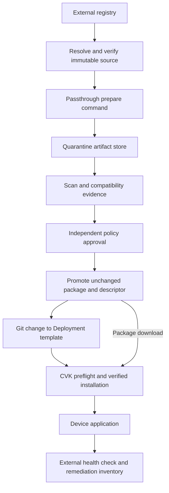

# Secure application image lifecycle implementation plan

Status: optional Verified Copy core lifecycle, recovery from lost lifecycle
replies and separate default Standard HTTP/HTTPS, preloaded-file and certificate
rejection controls, including leaf validity dates, qualified on one C9300-24UX /
IOS-XE 17.18.1 profile, 3 November 2026.
The CA-expiry and CRL-revocation follow-ups completed on 2026-11-04;
measured outcomes and the preserved warm-image limitation are linked below.
Cisco Virtual Kubelet (CVK) and docker-http-passthrough remain separate
repositories and deployable components. The artifact schema remains an
experimental interface. IOS-XE delivery supports the original experimental
gNOI path and an optional Copy profile using the existing RESTCONF copy RPC
with pinned SSH native file-size/SHA512 verification. Managed workers receive
per-device durable journals and bounded grants.

The [2 November core run](evidence/verified-iosxe-2026-11-02/README.md) passed
A → B → original A replacement, running-worker recovery and device-only
transfer corruption rejection. The
[3 November run](evidence/verified-iosxe-2026-11-03/README.md) passed an accepted
install with its reply lost, normal managed worker replacement and subsequent
activation/start without repeating install. The original fence expired normally;
no Lease or journal was reset. The
[follow-up reply run](evidence/verified-iosxe-2026-11-03-replies/README.md)
qualified independent lost activation and start replies on the corrected
candidate. Pending intents remained not Ready through untouched lease expiry,
then recovered without replay. Ready/HTTP health and Deployment availability
passed, and the stale top-level Pod reason/message defect was fixed and checked
on the device. Historical evidence remains bound to its original candidate.
The earlier gNOI File.Get limitation is specific to that service/profile;
the Copy/native-checksum method was qualified independently.
Governed functionality and its authorization schema remain future design work.
See [Verified artifact preflight](verified-artifact-preflight.md) for the usable
first increment and its limits.

Standard operation remains the default: users can deploy an existing HTTP(S)
package URL or device-local file without adopting the artifact contract or an
approval pipeline. The new approach is optional, with independent verification
and governance levels. Installing or upgrading either project does not opt an
existing user into additional requirements.

The [Standard control](evidence/standard-iosxe-2026-11-03/README.md) physically
checked this default on the corrected candidate: ordinary HTTP package
deployment, managed worker replacement, A → B update, history rollback to A and
normal deletion all passed without appArtifacts configuration, artifact
annotations, metadata endpoints, an artifact journal or its RBAC grant. Normal
worker configuration and mutation safeguards remained in use. A separate
[HTTPS/local follow-up](evidence/standard-iosxe-2026-11-03-https-local/README.md)
then passed positive HTTPS delivery and offline preloaded-file deployment with
Never, plus local running-worker replacement and normal deletion. It likewise
required no artifact metadata, journal or journal grant. Ordinary origin CA
trust was configured for the HTTPS test. The separate [certificate rejection run](evidence/standard-iosxe-2026-11-03-certificate-rejection/README.md)
qualified rejection of an untrusted CA and a mismatched hostname under a trusted
CA through the normal Standard pull and fallback flow. Both blocked package
delivery and readiness; correcting only the certificate allowed normal recovery
after the retained safety fence. No artifact metadata, journal or grant was
required. Independent qualification checksums are not a new Standard runtime
requirement. These results remain bounded to the recorded profile.

The separate [certificate-date run](evidence/standard-iosxe-2026-11-03-certificate-dates/README.md)
qualified expired and not-yet-valid leaf rejection with the same trusted issuer
and correct IP SAN through the actual Standard pull and fallback flow. Device
NTP time was measured without changing clock configuration. Both blocked
package delivery and readiness; replacing only the certificate recovered the
same Pod/app after natural safety-fence expiry. No artifact metadata, journal
or grant was required. These results cover the recorded C9300/IOS-XE profile;
root/intermediate expiry and CRL revocation are covered by the separate runs below.

In the separate [CA-expiry follow-up](evidence/standard-iosxe-2026-11-03-certificate-chain-expiry/README.md),
the C9K rejected both the expired imported root and the expired served
intermediate through native pull and fallback.
The root was imported while valid and expired naturally; NTP time was measured
without changing the clock. The intermediate case kept the root and leaf valid
and used a separate positive-control intermediate to avoid an alternate cached
valid path. Root replacement recreated only the run-owned CA trustpoint, renewed its trust
anchor and served root; intermediate replacement changed the served
intermediate only.
The server leaves, package URLs and payloads stayed unchanged. Post-replacement
health, fresh-Pod native delivery and normal deletion passed in both cases.
Recovery respected normal worker-controlled fences; no Lease or journal was
manually reset.
No artifact metadata or journal was required. Standard remains the default;
Governed remains deferred.

In the [CRL revocation follow-up](evidence/standard-iosxe-2026-11-04-certificate-revocation/README.md),
configured CRL checking rejected a revoked leaf and, in a separate
[uncached-image repeat](evidence/standard-iosxe-2026-11-04-certificate-revocation/cold-repeat/README.md),
a revoked intermediate. The fresh image had a new Docker configuration ID,
rootfs layer and application release. No fixture release ran before certificate
replacement; the same Pod then returned
`REVOCATION-COLD-20261104-35d8a9c90cb2`, and fresh deployment/deletion passed.
Root, leaf, CRLs and policy remained unchanged during intermediate replacement;
normal safety fences were respected. The explicit `revocation-check none`
control accepted the revoked leaf. In the original warm-image intermediate
case, known release A ran with a rejected handshake and zero new package
transfer; that evidence is preserved separately. Transport certificate
revocation alone does not block cached-content execution or prove a software
vulnerability was remediated. Verify the actual running release after updates.
This measured current, prepublished CRLs on the named C9300/IOS-XE profile;
leaf revocation discovery/cache refresh is covered by the separate run below. Ordinary PKI
configuration is optional and independent of CVK artifact mode. No artifact
metadata or journal was required; Standard remains the default and Governed
remains deferred.

The separate [leaf revocation-discovery run](evidence/standard-iosxe-2026-11-04-crl-refresh/README.md)
started with an unrevoked certificate and cached empty CRL, then published its
revocation at the same CDP. A fresh image still ran during the old CRL's valid
cache window. After natural expiry, the next application validation retrieved
the new signed CRL and rejected fresh delivery through native pull and fallback.
Publication to native retrieval was 510.8 seconds; retrieval occurred 11.3
seconds after NextUpdate, including the gap before the next connection. These
are measured times for the fixture's ten-minute initial CRL, not a universal
refresh deadline. Replacing only the leaf certificate/key recovered the same
Pod after normal fence expiry; the actual release, fresh delivery and normal
deletion passed. Two serial-specific native PKI errors establish rejection; the origin recorded
only the fallback alert, and its stricter raw result is preserved. Initial
prepublication harness stops and raw observer evidence are also preserved. No cache policy, clock, Lease or journal was reset. Intermediate
discovery and its failed fresh-execution result are covered below; unavailable
CRLs and cache-policy overrides remain unqualified.
Standard remains the default without artifact metadata or journals; Governed
remains deferred.

The [intermediate revocation-discovery follow-up](evidence/standard-iosxe-2026-11-05-intermediate-crl-refresh/README.md)
observed CRL refresh and a serial-specific native revocation error, but did
**not qualify fresh execution blocking**. A new root/intermediate/leaf hierarchy
and three different image configurations/layers excluded prior valid chains and
preloaded target images. A fresh image ran during the old CRL cache window.
After natural expiry, the C9K fetched the root-issued revocation list 524.2
seconds after publication (9.0 seconds after NextUpdate, including the next
validation gap). No refresh-image GET followed, yet the new Pod became Ready
and its endpoint reported the previous day's leaf-test release. Native RUNNING
predated intermediate replacement; the first HTTP release proof came afterward,
with no intervening package transfer. The internal reuse mechanism is unproven.
The worker treated installation as successful, so copy fallback was not invoked.
Certificate-only replacement did not repair the already-running stale release;
normal deletion and a new Pod under the corrected chain finally delivered and
ran the requested image. All evidence and the failed outcome are retained.
This demonstrates that Pod Ready and TLS revocation do not establish successful
image replacement. No production change, cache prune, Lease/journal reset or
mandatory artifact mode was introduced. Standard remains default and Governed
deferred; unavailable CRLs and cache-policy overrides remain unqualified.

The subsequent [Standard copy-first fix and requalification](evidence/standard-iosxe-2026-11-05-copy-first/README.md)
changes remote delivery to use the existing synchronous RESTCONF copy RPC before
app configuration or installation. CVK requires the qualified completion result,
then installs only from the explicit local path. Failed copies cannot proceed
through native URL installation, unchecked cache filenames or recovery
reconciliation. The default staging file is directly under flash, with no new
directory setup. New Always and IfNotPresent installations require a completed
copy; existing app reconciliation and preloaded local Never remain supported.
The final candidate blocked fresh execution after intermediate revocation
discovery, including across managed worker replacement. Certificate-only repair
recovered the same Pod and exact requested release after the untouched fence;
a fresh IfNotPresent deployment and local Never with its origin offline also
passed, including a local worker restart. The initial missing-parent failure,
its candidate and natural fence expiry are preserved alongside the final run.
An admission-blocked harness restart was preserved and resumed through the
manager; an expired CRL was renewed with the same revoked serial before the
certificate-only recovery phase.
The prior stale-runtime failure report remains unchanged. Standard requires no
artifact metadata or journal; optional Verified still supplies cryptographic
package identity and durable recovery. Existing running apps are not silently
reidentified or repaired by upgrading the worker. Governed remains deferred.

The [copy-first Standard upgrade and rollback qualification](evidence/standard-iosxe-2026-11-06-upgrade-rollback/README.md)
retains the same candidate and verifies A → B → A using a single Deployment and
actual Deployment-history undo. After both images had previously run, with no device image cache pruning, an
HTTPS 404 for B blocked configuration, installation, runtime and Ready. Explicit
history rollback to A respected the original unchanged mutation fence, then
completed a fresh copy and served the exact A release. Restoring B's source
allowed a further upgrade and history rollback. Every successful revision used
a new Pod and a device-local install after confirmed copy completion. No artifact
metadata or journal was needed, and the earlier evidence remains unchanged.
The lab used Recreate with one fixture slot: the old app was removed first, so
failed upgrade and fence recovery caused an availability gap. RollingUpdate,
zero-downtime capacity and automatic vulnerability selection are outside this
run. Retired staging tars remained on flash after native app deletion and were
removed by lab cleanup; automatic flash cleanup was not qualified for that
earlier candidate. Keep versioned upstream packages available for history rollback.
Standard remains default and Governed deferred.

The later [ownership-safe Standard staging cleanup qualification](evidence/standard-iosxe-2026-11-06-staging-cleanup/README.md)
uses a rebuilt candidate and adds automatic cleanup for freshly allocated,
proven-owned temporary tars. Remote A/B upgrades and actual history rollback
passed with each consumed tar confirmed absent while the app ran. A truncated
HTTPS upgrade was blocked before configuration/install and its destination was
confirmed absent; rollback respected the unchanged natural fence. A preloaded
archive with a matching staging-style filename retained its exact size/SHA-512
through all boundaries and passed local Never deployment before and after.
Existing tar inventory and earlier evidence were preserved. The lab did not
manually delete any worker-owned path under test. This firmware left no partial
file after the failed transfer; actual partial-residue deletion is unit-tested.
Preloaded/explicit destinations, legacy files, uncertain operations and files
without a live ownership receipt remain retained. Worker-crash orphan collection
is outside this bounded cleanup contract. Standard still needs no artifact
metadata or journal; Verified is optional and Governed deferred.

The full governed path acquires an external image by digest, verifies and
assesses it, prepares a device-compatible package once, authorizes that exact
artifact, then replaces application Pods in bounded cohorts. This path consumes
retained artifacts, with conversion outside the device installation request.
Existing on-demand passthrough downloads remain a supported simpler workflow.

## Optional adoption and defaults

| Mode | User workflow | Additional requirements |
| --- | --- | --- |
| Standard, default | Supply a package URL or local path and use the existing CVK lifecycle; passthrough is optional | No descriptor, approval service, scan policy, signed grant, catalogue heartbeat or new artifact resources |
| Verified, opt-in | Select a prepared immutable artifact and verify its identity before installation | Signed descriptor, configured producer/delivery trust, qualified on-device checksum and installation evidence |
| Governed, opt-in | Add vulnerability policy and controlled release authorization to Verified | Fresh assessment evidence, scoped expiring grants, revocation snapshots, accepted release transitions and automated campaign gates |

Standard and experimental Verified are accepted configuration values; Governed
is not implemented or accepted yet. Default chart values and omitted configuration
select Standard. Once Verified device execution is qualified, administrators can
opt a device pool into it; there is no cluster-wide promotion merely
because the feature is installed. Mode selection comes from protected operator
configuration, and a workload cannot downgrade a pool's selected mode.

Standard is a supported mode, not a deprecated compatibility path. Its users
retain existing device/package trust settings and can still use versioned
images, CI scans, GitOps and ordinary Deployment updates without integrating
signed deployment authorization. Verification status is informational; absence
of optional evidence is not an error in Standard.

Verified has no dependency on a scanner, expiring deployment grants, approval
renewal, revocation-feed availability, release-transition catalogue or first-use
zero-replica enrollment. It uses configured store locations, a signature
sidecar and producer trust; a live catalogue is not required. It checks exact
package identity without asserting CVE compliance.
Cached artifacts can be reused after verification under that configured trust.

Governed enforces the full authorization design below. Approval can be issued
automatically by policy; it does not inherently require a manual decision for
every release. Expiry/revocation and rollback-transition rules apply only here.
Both opt-in modes fail closed for the checks they promise; neither silently
falls back to Standard when verification fails.

Baseline fixes such as credential scoping, upstream content-integrity checks,
resource limits and accurate status reporting benefit all modes. Implement them
without requiring users to deploy a governance system. Document any necessary
authentication/configuration migration separately from optional governance.

## Decisions and initial scope

| Decision | Implementation consequence |
| --- | --- |
| Keep both projects independent | Share versioned schemas and conformance fixtures; neither project imports the other's runtime implementation. |
| Preserve a simple default | Standard URL/flash workflows remain supported without optional artifact/governance resources. |
| Prepare before verified deployment | Add a passthrough `prepare` command for Verified/Governed. Existing on-demand delivery remains supported. |
| Separate identity from permission | Verified uses immutable descriptors; Governed additionally uses signed deployment authorizations. |
| Use Kubernetes replacement | Change a Deployment's Pod template. An existing Pod UID cannot silently switch artifacts. |
| Verify before execution when opted in | Verified/Governed stage and verify the on-device package before install, including platforms where install can auto-start. |
| Preserve honest evidence | A verified package plus installation receipt is distinguished from an observed runtime digest. |
| Start with a bounded platform | Qualify one IOS-XE device family, OS release, Linux/amd64 payload and package format before expanding. |
| Keep policy external | Existing CI/security tooling owns release discovery, CVE rescanning, exceptions, approvals and cohort promotion. |

The first Verified/Governed release supports managed CVK, regular containers in
Deployment-owned Pods, one qualified delivery/authentication combination,
and external application health checks. Bare Pods, init/ephemeral containers,
general offline authorization, direct OCI references in `container.image`,
NX-OS secure delivery and automatic flash garbage collection are deferred.
These initial feature limits do not narrow existing Standard support. A
Standard deployment does not claim the additional assurances of the opt-in modes.

The converter can produce Docker-save archives. Targets requiring IOx package
signatures need a separately qualified packaging/signing step. An OCI
signature does not produce an IOx signature. Strict delivery must reject a
target whose package trust requirements cannot be met; enabling unsigned
applications is not an implicit part of this feature.

CVK accepts artifacts from any producer that satisfies the configured contract
and trust policy. Provide an optional joint installation example with pinned
component versions; passthrough remains an optional infrastructure service,
not a required sidecar or dependency of every CVK worker.

## Governed architecture and ownership

This diagram describes the full optional integration. Standard users need none
of the added pipeline components. Verified omits assessment, deployment approval
and release-transition enforcement, while retaining package identity checks.



| Owner | Owns | Does not receive |
| --- | --- | --- |
| Passthrough project | Registry acquisition, content verification, deterministic export, conversion provenance, bounded preparation | Device-management credentials or deployment approval authority |
| Release/security pipeline | Source trust, scans, qualification, promotion, signing authorization, revocation and Git changes | Unnecessary device administration access |
| Artifact store | Immutable package/evidence retention, authenticated HTTPS delivery, access logs | Authority to declare a package safe merely because it is downloadable |
| CVK manager | Trusted policy, scope validation, device binding, protected installation records | External registry acquisition responsibilities |
| CVK app worker | Scoped artifact transfer, verification, device lifecycle and attributable observations | Permission to approve artifacts, modify trust roots or rewrite Deployments |
| Fleet operator | Maintenance windows, cohort limits, service checks and exception decisions | An assumption that Pod Ready proves remediation |

Run conversion on ordinary infrastructure, independently of the switch fleet
being updated. Use separate service identities for acquisition, promotion,
deployment approval, device downloads and CVK execution. A deployment approval
key must not be mounted in the converter or an app worker.

## Artifact contract

The initial wire version is `apphosting.cisco.com/v1alpha1`. This is a proposed
protocol identifier, not a Kubernetes API registration or a new CRD. JSON
Schema Draft 7 is used for cross-language validation.

The descriptor is required only in Verified/Governed. Deployment authorizations,
security assessment freshness and release transitions are Governed-only. Standard
does not need to understand these records to continue operating.

| Record | Purpose | Authority and lifetime |
| --- | --- | --- |
| Artifact descriptor | Bind source image, platform, producer and exact package bytes | Immutable; signed by an accepted producer identity |
| Evidence objects | Store SBOM, scan, source-verification and qualification results | Immutable; content addressed and attributable to the relevant evaluator |
| Deployment authorization | Permit a descriptor for a specific deployment scope and interval | Signed by policy authority; renewable and revocable |
| Delivery binding | Select mirror, TLS trust and credentials for a target | Administrator-controlled configuration; frozen per operation |
| Installation record | Bind desired artifact to verification, device operations and observed health | Manager-owned durable journal with constrained worker reports |

### Descriptor

The draft [descriptor schema](contracts/app-hosting-artifact-v1alpha1.schema.json)
and [example descriptor](contracts/examples/app-hosting-artifact-v1alpha1.json)
define these fields:

| Field | Required meaning |
| --- | --- |
| `source.registry`, `source.repository` | Canonical upstream identity; no credentials or query parameters |
| `source.requestedDigest` | Digest supplied to acquisition; a tag is not an acquisition identity |
| `source.indexDigest` | Optional selected image-index provenance |
| `source.manifestDigest` | Required selected-platform manifest digest |
| `source.configDigest` | Image configuration digest, distinct from the manifest and archive |
| `source.platform` | Explicit OS, architecture and optional variant; validate both index and single-manifest inputs |
| `source.releaseLabel` | Optional human-readable release label; informational only |
| `package.format`, `mediaType` | Exact output format and media type; schema recognition does not imply device support |
| `package.digest`, `sizeBytes` | SHA-256 and exact byte length of the final package, after any wrapping/signing |
| `producer` | Producer name/version/build digest and immutable recipe digest |
| `provenance` | Digest/media type of evidence linking inputs, intermediate packages, recipe and final bytes |
| `sbom` | Optional evidence reference; Governed policy requires an adequate SBOM or an explicit exception |
| `createdAt` | Historical production time; not proof of scan freshness |

For direct manifest input, `requestedDigest == manifestDigest` and
`indexDigest` is absent. For the initial single-index path,
`requestedDigest == indexDigest`; the selected child must belong to that
verified index. Nested indexes require explicit later support, not heuristic
selection. Validate descriptor sizes, config architecture, layer ordering
and uncompressed diff IDs. A missing platform fails closed.

The descriptor does not contain `approved: true`, current vulnerability state,
credentials or authoritative download locations. A new scan or mirror does
not change artifact identity. Repackaging changes the final package digest
and requires a new descriptor, plus a new authorization in Governed, even if
the source image is unchanged.

### Deployment authorization and evidence

This subsection applies only to Governed. Verified does not require these
grants, UID enrollment or the release-transition protocol.

The draft [authorization schema](contracts/app-hosting-deployment-authorization-v1alpha1.schema.json)
and [example authorization](contracts/examples/app-hosting-deployment-authorization-v1alpha1.json)
bind permission to:

- An exact descriptor digest and a unique authorization ID.
- `deploy` or `rollback`, a cluster identity, namespace name/UID, Deployment
  name/UID, container name, release/transition IDs, predecessor release and
  content-addressed target qualification profiles.
- Issue, not-before and expiry times, plus the evaluated policy digest.
- Exact source manifest and package digests, scan report, scanner version,
  vulnerability database identity/time, scan time and qualification evidence.
- Source trust evidence and narrowly scoped exception evidence where required.

The signature's verified identity establishes the issuer; an issuer name
inside JSON cannot grant trust. The policy evaluator checks relationships
that JSON Schema cannot express: evidence subjects match the descriptor,
time ordering is valid, scan/database freshness meets policy, the target
profile is currently accepted, and the action matches the protected release
transition. The grant's `policyDigest` must match the active evaluation policy
or an explicit administrator-approved compatibility set. An exception
object cannot relax unrelated checks such as package integrity or identity.

Authorizations approve artifact use in the named scope. They do not approve
arbitrary commands, privileges, mounts, Secret access or other workload
configuration. Existing Kubernetes admission, RBAC and Git review continue
to govern those fields.

Do not embed a short-lived authorization digest in the Pod template. The
template identifies the artifact and a stable release ID; an
administrator-controlled catalogue resolves the current authorization for
that exact scope. Renewing permission or rescanning unchanged bytes therefore
does not restart applications. Each installation/retry records the exact
authorization digest and policy revision it actually used.

The protected catalogue maintains a current/pending transition per Deployment
UID and container: transition ID, predecessor release ID, new release ID,
descriptor digest and required action. `scope.fromReleaseID` is null only for
initial enrollment. The trusted promotion principal requests a transition;
the manager validates it against retained release history and freezes it with
CAS. The worker obtains the expected action from that accepted transition,
never from an annotation or whichever grant happens to be available.

Returning to a superseded artifact requires a new release ID and a `rollback`
transition/grant; minting a new ID cannot disguise a previously superseded
descriptor/package/source as a forward release. Old deploy grants and retired
release IDs cannot reactivate a release. Routine replacement within the active
release reuses its accepted transition and a current deploy/rollback grant as
appropriate. Already-running predecessor Pods may finish the rollout, but new
predecessor execution needs explicit current permission rather than a leftover
grant. Include this availability tradeoff in the cohort plan.

For first enrollment, create the Namespace and a zero-replica Deployment,
capture their UIDs, then issue its initial grant and scale it through GitOps.
Delete/recreate requires reenrollment; names cannot inherit the previous UID's
grant. Renewal preserves these bindings and does not alter the Pod template.

### Hashes, signatures and parsing

Hash and sign the exact published UTF-8 JSON bytes, including their final
newline. Consumers retain and verify those bytes before decoding; they must
not reserialize JSON to reconstruct a descriptor digest. Producers emit
stable formatting. Any byte change yields a new digest. Signature bundles
are detached from the signed payload to avoid circular identity.

Provenance subjects the final package digest and its inputs; it does not
reference the enclosing descriptor digest. The descriptor can therefore
reference provenance without a circular hash dependency.

Verified retrieves a bounded signature sidecar at
`/v1/descriptors/sha256/<descriptor-hex>.sigstore.json` from the configured
store, verifies the exact descriptor bytes against configured producer trust,
and records the accepted bundle digest. The sidecar can be replaced for
legitimate re-signing; it cannot change the signed descriptor identity or grant
trust to a new signer. This path requires no live approval/catalogue service.

In Governed, the protected catalogue maps each descriptor/authorization payload digest to
one to four detached signature bundle digests. Retrieve bundles from
`/v1/signatures/sha256/<bundle-hex>.sigstore.json`, verify their bytes against
the catalogue digest, then verify the payload signature using the locally
configured signer-role policy. Bound each bundle to 1 MiB and reject excess
candidates. Record the accepted bundle digest. Re-signing publishes a new
immutable bundle and updates the catalogue revision; it does not rewrite the
payload or overwrite an existing bundle. Key rotation updates trusted signer
policy and revalidates pending operations, with explicit overlap/revocation.

Use established Sigstore/Cosign blob signing and verification with an
administrator-configured trusted key, or exact certificate identity and
issuer. Verify the payload and signing evidence with maintained libraries.
Producer and deployment-approver trust policies are distinct. Source signature
verification uses its own supplier identity policy; a converter signature
does not substitute for supplier provenance.

Reject duplicate JSON keys, unsupported versions, unknown fields, malformed
digests, oversized metadata and unsupported algorithms before use. Initial
limits: 256 KiB per descriptor/authorization, bounded nesting, SHA-256 only,
and positive sizes within implementation and configured transfer limits.
Schema validation is necessary but is not signature, authorization or device
verification. Missing required evidence cannot silently become a pass.

The checked-in examples use synthetic package/evidence hashes and have no
valid signatures. The authorization's descriptor hash matches the exact
example file; the example cannot authorize a real deployment.

### Delivery and Pod binding

Use an existing HTTPS store with a content-addressed layout, proposed as:

```text
/v1/packages/sha256/<package-hex>/package.tar
/v1/descriptors/sha256/<descriptor-hex>.json
/v1/evidence/sha256/<evidence-hex>
/v1/signatures/sha256/<bundle-hex>.sigstore.json
```

These are storage conventions, not new passthrough server endpoints in the
MVP. Descriptor/signature/evidence retrieval is from configured origins.
Store access authorization and permission to execute remain separate.

The proposed Pod-template annotation is `cisco.io/apphost-artifacts`, a
bounded JSON map keyed by regular container name. Verified requires only
`descriptorDigest`; Governed additionally requires `releaseID`. Standard
requires neither. This example shows a Governed binding:

```json
{
  "agent": {
    "descriptorDigest": "sha256:c1eeab4f2eff6127a34878ba3d2c2f3d08029dfcd402d00dd3aaac3eb2015b9f",
    "releaseID": "fb600a56-77fb-4e36-bbe9-20ab8fe13f02"
  }
}
```

`container.image` remains the canonical immutable package HTTPS URL in the
first version. Validate its origin, exact path and digest against the
descriptor and trusted store configuration. A checksum-looking substring in
an arbitrary URL is insufficient. Require exactly one binding for every
supported container; reject duplicate/unknown entries and unsupported Pod
features before device mutation.

The manager selects a site mirror from protected inventory and administrator
policy. Every permitted mirror must serve identical package digest/size.
Resolve and freeze the concrete origin, TLS trust, credential identity and
artifact path before dispatch. Mirror retries may change origin only through
the configured policy and a new recorded binding; artifact identity remains
unchanged. Never accept workload-supplied trust roots, arbitrary Secret names,
userinfo URLs or expiring signed query URLs in Git or the immutable descriptor.

### Revocation, clock and offline semantics

This subsection governs Governed deployment permission. Standard and Verified
do not contact this policy/approval service or inherit its expiry/availability
requirements. Operator changes to configured producer trust still apply to
Verified; neither mode claims the continuous CVE compliance of Governed.

For the first release, use an RBAC/admission-protected policy ConfigMap in the
CVK control namespace, reconciled by the trusted security/promotion principal.
It carries the active evaluation policy digest, monotonic snapshot generation,
accepted signer/profile identities, authorization/descriptor/source revocations,
freshness limits and trusted `asOf`/`validUntil` timestamps. The security
principal refreshes the snapshot only after completing its policy/revocation
sync; a manager read cannot extend its validity. App workers
cannot modify it. A managed catalogue supplies the current signed grant;
the manager validates the live scope and gives the worker a bounded binding.
Workers independently validate cryptographic evidence and the binding.

Persist the accepted policy generation and reject replay of older policy or
revocation state, including across manager restart. An intentional policy
rollback is a new generation, not permission to decrease the counter. A
watch cache alone cannot prove revocation freshness: validate current policy
at operation dispatch and immediately before the execution boundary. Define
the dispatch lease and maximum staleness in policy and measure the race bound;
do not promise instantaneous cancellation of a device operation already sent.
A direct API read of an expired snapshot still fails freshness. Keep snapshot
generation separate from the evaluation policy digest: adding a revocation
does not force all unaffected grants to be re-signed. Tightening evaluation
policy invalidates grants under unaccepted older policy digests even if their
time window has not expired.

Use a trusted UTC clock with a bounded skew allowance. Conservative starting
defaults for qualification are scans/database snapshots no older than 24
hours and authorizations no longer than 6 hours; make these operator policy,
not hard-coded security claims. Reauthorize an operation that outlasts its
permission. Larger disconnected-site windows need a separately approved design.

Expired, revoked or unavailable fresh authorization blocks new execution and
retries, including activation of an already-staged package. It does not
silently stop an existing running service. Containment/removal is an explicit
action. Cleanup and observation remain available when approval expires.
The MVP blocks new execution offline. A later signed, scoped, bounded offline
exception must acknowledge that immediate revocation cannot be learned while
disconnected; a production offline update system should evaluate
[TUF metadata](https://theupdateframework.github.io/specification/v1.0.36/)
rather than improvise rollback/freeze protection.

## Passthrough workstream

All listed new modules/commands are proposed. Passthrough remains useful
without Kubernetes. Its production preparation input is a configured registry
binding, repository, immutable digest and explicit platform.

| PR | Scope and code anchors | Dependency | Acceptance gate |
| --- | --- | --- | --- |
| DHP-1 Contract and preparation interface | Add `src/artifact.rs`, `src/reference.rs`, a `prepare` command and versioned schema fixtures; refactor `src/main.rs` into reusable preparation/server entry points | Joint contract review | Parse digest-based input without filename tricks; emit schema-valid records; reject tags in production preparation |
| DHP-2 Verified deterministic conversion | Update `src/registry.rs` and `src/tar_builder.rs`; add content-integrity and archive-compatibility tests | DHP-1 | Hash manifests/config/layers; check sizes/diff IDs/platform; produce identical tar bytes for identical inputs, recipe and producer build |
| DHP-3 Registry credential boundary | Add configured registry bindings and policy; update routes, `.env.example` and auth/error handling | DHP-1 interface | Unapproved host, token realm, redirect or repository receives no credentials; legacy arbitrary-target routes disabled by default in secure deployments |
| DHP-4 Bounded atomic preparation | Add preparation/limits modules, bounded temp workspace, cancellation, atomic finalization and a standard-store publishing example | DHP-2 and DHP-3 | Oversize, timeout, cancellation, disk-full and failed publication expose no approved release; retries preserve finalized identity and do not overwrite immutable output |
| DHP-5 Hardened packaging and releases | Update `Dockerfile`, `kubernetes.yaml`, CI and `container-image.yml`; enable converter SBOM/provenance/signing and scan policy | Can proceed in parallel | Non-root, bounded writable storage, restricted permissions/egress, pinned production image and verifiable releases |
| DHP-6 CVK integration qualification | Add `examples/cvk-artifact-pipeline/` and update Cisco workflows/validation documentation | DHP-2 through DHP-5 and CVK secure path | Reproducible prepare/publish/install/update/rollback on the named qualified target, with immutable evidence |

DHP-2 must hash the raw registry bytes before expensive decompression or use.
Enforce compressed descriptor sizes, bounded expansion and uncompressed diff
IDs. Normalize tar metadata and ordering. Use a deterministic valid internal
RepoTag derived from content, qualified with the device loader; never generate
`repo:sha256:...`. Human release labels stay in provenance, not archive identity.
Explicitly reject unsupported media types, nested indexes and zstd until
qualified support exists.

DHP-3 binds registry origin, permitted repositories, token service and scoped
credentials to a named administrator-owned configuration. Control DNS,
redirects and network egress as well as URL strings. Private enterprise
registries are legitimate; policy must authorize exact destinations rather
than indiscriminately rejecting private addresses. Block cross-origin
credential forwarding and HTTP downgrade. Use dedicated service authorization
if the HTTP interface is exposed; a syntactically valid registry Basic header
is not that authorization. Bound/redact upstream error bodies and telemetry.

DHP-4's Verified path prepares/signs the artifact and publishes it to an
existing store. Publish complete package, evidence and signature dependencies
before exposing the signed descriptor as ready. It needs no quarantine/promotion
roles or release-catalogue service. In Standard, users can continue requesting
an on-demand archive without this publishing workflow.

The optional Governed pipeline writes outputs into quarantine. A separate
publisher uses conditional create/immutable object policy for package,
descriptor, evidence and signatures. Upload and verify all dependencies first,
then CAS-publish one protected catalogue entry binding the complete release
and transition. That entry is the publication commit point. CVK cannot deploy
objects merely because they are downloadable; interrupted publication before
the commit leaves the release unauthorized. Retried publication verifies the
existing objects and commit rather than overwriting them. Ordinary object
storage does not provide a transaction spanning all these files.

Define a preparation key as SHA-256 of
[RFC 8785 canonical JSON](https://www.rfc-editor.org/rfc/rfc8785) containing
canonical source registry/repository, requested and selected digests, platform,
output format, producer build digest and recipe digest. Exclude credentials,
mirrors, scan dates and wall-clock retry time. Persist the finalized descriptor
and its original `createdAt` under that key; a retry reuses it. A CI publishing
index with conditional create selects one finalized record across concurrent
jobs. A deliberate new production record is distinct from retrying a completed
preparation. Identical tar bytes alone do not imply identical descriptor bytes.

Do not give the converter an approval signing key.
The store supplies tested GET/HEAD/Range, exact Content-Length and stable
download behavior. ETags are cache validators, not universally SHA-256 hashes.
Private caches must enforce access control. Protect active, staged and retained
rollback artifacts from TTL deletion.

Defer a network preparation API, shared work queue, distributed cache and
multiple storage SDKs. A CLI invoked by CI plus one established store is the
first complete product increment. Later services can wrap that same verified
preparation library after a concrete scaling need is measured.

## CVK workstream

Standard is the default. Verified and Governed are selected independently by
trusted operator configuration, initially for managed workers. A Pod annotation
cannot downgrade the selected mode or select its own trust policy. Preserve
current device mutation fencing and maintenance ownership through every new
transfer, verification and lifecycle operation. Below, "strict delivery" means
the integrity guarantees of Verified/Governed; authorization checks are
additional Governed-only behavior.

| PR | Scope and code anchors | Dependency | Acceptance gate |
| --- | --- | --- | --- |
| CVK-0 Device capability qualification | Lab harness/runbook; inspect `internal/provider/softwareupgrade/reconciler.go` and `internal/drivers/iosxe/gnoi/file.go` | None; runs alongside contract work | One named device/OS/package/auth path proves verify-before-execute, including corrupt/truncated bytes and unsupported algorithms |
| CVK-1 Independent artifact verifier | Part A: bounded descriptor decoding, signatures/platform and fixtures. Part B: optional grant/scope/freshness evaluation | Joint contract | Part A rejects identity/integrity failures; Part B adds Governed approval checks |
| CVK-2 Trusted bindings and durable records | Part A: installation binding/journal and scoped worker reports. Part B: optional release catalogue, grant enrollment and transitions | CVK-1 corresponding parts | Part A survives restart with correct identity; Part B prevents unauthorized release/approval changes |
| CVK-3 Explicit verified delivery | Add typed optional package verification capability; update IOS-XE `client.go`, `types.go`, `pod_transforms.go` and provider dispatch; extract bounded file hashing helper | CVK-0 and CVK-1A/2A only | Copy or verify prestaged bytes before install; no dependency on completion or availability of Governed services |
| CVK-4 Credential and cache correctness | Repair delivery-host credential matching; add digest paths, incomplete-file state, quota and reuse verification | CVK-3 | No cross-host credential use, token silently ignored, stale package reuse or multi-container path collision |
| CVK-5 Replacement and evidence semantics | Update IOS-XE `pod_lifecycle.go`, `status_transforms.go`, NX-OS `pod.go`/`status.go`; native admission plus worker defense | CVK-2A; tested with CVK-3/4 | Honest status and safe replacement apply without adopting Governed |
| CVK-6 Optional integration examples | Separate Standard quick start, Verified example and Governed CVE pipeline; chart wiring and health/operations docs | Verified example after CVK-3/4/5; Governed example also needs CVK-1B/2B | Each mode works independently; default installation creates no governance resources |

### Preflight and policy enforcement

Validate the complete Pod in the provider before configuring any container.
Standard uses existing validation without requiring artifact records. Verified
checks descriptor/signature, delivery origin, platform and on-device package
integrity without any deployment grant or UID enrollment. The remainder of
this paragraph describes the additional Governed scope enforcement.
Resolve its actual Deployment ownership chain through Kubernetes, freeze the
namespace/owner/Pod/device UIDs and compare the grant's scope with trusted cluster and
namespace policy. An ownerReference, claimed Git SHA or `approved` annotation
alone is not authority. Apply placement/admission controls so untrusted Pods
cannot opt into privileged device pools or bypass the selected policy.

Native ValidatingAdmissionPolicy handles required fields, protected resources
and same-UID immutability. CEL is not an external signature verification engine;
cryptographic verification belongs in manager/provider preflight. A later
webhook can improve rejection latency but is not required to prove the first
secure flow. Keep worker-side enforcement even when admission is installed.

Use manager-owned ConfigMaps for the initial bounded binding/journal protocol,
with exact-resource worker report permissions and admission tied to the
current Pod/device/worker identity. Separate desired/accepted fields from
untrusted worker reports. App workers currently cannot write arbitrary Pod
metadata; do not put protected receipts in worker-written annotations. Specify
resource size/retention limits, CAS transitions, cancellation and stale-worker
rejection. This is new work; the existing managed admission provides patterns,
not an already-implemented artifact receipt protocol. Consider a typed CRD only
when the protocol or fleet scale outgrows these native resources.

Install only the resources selected by the mode. Verified needs its execution
journal and trust configuration, not the Governed policy heartbeat, grant
catalogue or transition history. Standard creates none of these new artifact
resources. Preserve each mode's upgrade path independently.

The scoped execution worker is trusted to report its device observations.
Manager identity/consistency checks and admission prevent unauthorized writes
and stale/cross-device reports; they cannot make a compromised authorized
worker's hash or RUNNING report truthful. Independent device verification is
an additional assurance boundary if malicious execution workers are in scope.

### Verification and lifecycle state machine

The proposed Verified operation states are:

```text
Requested -> IdentityVerified -> Staging -> PackageVerified
          -> Installing -> Installed -> Starting -> Running -> AppValidated
```

Record failures, revocation holds and ambiguous device outcomes separately.
Governed adds authorization before staging and execution and records grant
revocation holds. Verified has no grant-expiry or approval-service gate.
Persist intent before a device RPC and observation after it. Recovery observes
the exact device/app/file state before replaying anything; it cannot infer
success from an accepted request or a timed-out response. Recheck current
identity/trust before install and again before activation/start where those
are distinct execution boundaries. Governed also rechecks current authorization.

The operation-bound gate applies in `CreatePod`, `UpdatePod`, `ReconcileApp`,
asynchronous status recovery and the lowest install/activate/start dispatch
paths. No background repair may bypass the mode's integrity checks or, in
Governed, current permission. If observations
cannot correlate an ambiguous result and prove a retry safe, persist
`ExecutionOutcomeUnknown` and hold for investigation; do not automatically
delete/reinstall to clear uncertainty. Tests must exercise expired permission
between status polling and recovery, and lost install/start responses.

Verified delivery strategies are `CopyThenVerifyInstall` and
`PreStagedVerified`, also used by Governed. A separately
qualified native installation mechanism could be added later. The legacy
native-URL-first timeout fallback is removed from Standard by the copy-first
fix described above. Verified additionally requires package verification before
installation, so a remote URL must never reach its install operation.

The existing OS-upgrade helper `verifyDeviceFileDigest` reads a complete file
with gNOI File.Get, computes SHA-256 locally and compares both the expected
digest and terminal server hash. Extract the mechanism behind a typed app
package verifier, add exact size and transfer bounds, and qualify access to
the app-package filesystem. File.Stat size alone is insufficient. This approach
adds a full readback transfer and must be included in capacity/time budgets.

Do not assume `verify /sha256` is portable: the repository has a real-device
invalid-syntax fixture for that command. No general app-hosting checksum RPC
is established by this plan. Unsupported device verification is a capability
failure, not permission to trust a filename or server-provided checksum.

Grant app workers only the qualified read-only file capability and device AAA
scope they need; a restricted Go interface does not restrict the credentials
on the device. Do not copy broad network-worker credentials into app workers.
If least-privilege direct readback is unavailable, qualify a separately fenced
verification service or leave that target outside the secure release.

Hold the mutation fence across verification and install, use content-addressed
paths and prevent CVK writers from replacing the file. The trust model assumes
the device and its administrators are trusted; readback followed by install is
not remote attestation against a compromised host. Reverify after interruptions
or suspected file replacement. A signed-package mechanism can add device-side
enforcement where independently supported.

### Credentials and storage

Upstream registry credentials stay in the preparation pipeline. Device delivery
uses a separate host-scoped credential configured by the operator. Match
normalized scheme/host/port and applicable path scope, validate redirects, and
redact secrets from all events/errors. A bearer-only credential that the device
cannot transmit must be rejected rather than silently ignored. Qualify the
device's actual TLS CA/hostname validation, not just CVK's RESTCONF TLS client.

Use a full-package-digest cache path in a CVK-owned directory, with separate
operation-specific incomplete files when supported. Verify size and digest
before reuse and before execution. Do not use the current Pod-wide fixed
package destination in strict mode. For multi-container workloads, name-based
bindings and immutable package paths prevent aliasing; qualify container/app
count limits and partial-install recovery.

Where filesystem rename is not proven atomic, persist incomplete state and
never install from it until verification completes. Serialize conflicting
operations. Enforce free-space reserves and bounded transfer concurrency.
Initially provide inventory and explicit cleanup of unreferenced CVK-owned
packages. Automatic deletion waits for proven reference accounting covering
active apps, pending operations and rollback retention; never delete unrelated
flash content.

### Replacement and reporting

Store the accepted artifact binding for each Pod UID/container before install.
Reject an image or artifact-binding change on that same Pod UID with the
proposed reason `ImageReplacementRequiresNewPod`, without disrupting the
running app. Check this independently of admission and after worker restart.
Permit unrelated metadata updates. An unknown Standard identity cannot be adopted
as verified; perform a controlled replacement.

Distinguish requested source, verified package, installation receipt,
app-hosting RUNNING, application validation and actual runtime image identity.
`ImageID` contains only a genuinely observed runtime identity if available;
otherwise leave it unknown and expose the package/receipt evidence separately.
Never put the desired URL or source digest there to imply an observation.

An installation record binds cluster, namespace, controller UID, Pod UID,
container name, device UID, app ID, descriptor/package digests, delivery binding,
verifier method, operation identity and timestamps. Governed adds the exact
grant, transition and policy revision; these fields are absent in Verified.
A terminal receipt can be immutable while a separate bounded
journal retains pending transitions. It proves the verified-install chain
under the device trust assumption; it does not invent runtime digest support.

The first health gate runs outside the provider and correlates a meaningful
application check with the new device/app/Pod identity. A trusted health job
must not let a workload choose arbitrary internal URLs or credentials. Keep
Pod Ready's present meaning explicit. Delay additional cohorts until both the
installation evidence and service/version checks pass; `minReadySeconds` is
only a settling interval. General provider probe support is later work.

## Vulnerability remediation workflow

This is the optional Governed reference workflow. Standard and Verified users
can use their own CI scans, Git updates and rollout practices without adopting
its signed grants, revocation feed, enrollment or catalogue. They do not claim
the additional enforcement described here.

The reference implementation belongs in a new `examples/app-image-lifecycle/`
directory in CVK, with converter-specific preparation examples in passthrough.
Use existing CI, scanner, store and GitOps components; avoid a new general
release controller for the first milestone.

1. Maintain an inventory keyed by source manifest, descriptor and package
   digest, mapped to device/app/Pod identities and evidence level. Rescan both
   deployed and retained approved artifacts when the vulnerability database
   changes, even when no source tag changes. Run a separate watcher for new
   upstream releases and digest changes behind existing tags.
2. Assess findings by affected component, exploitability, exposure, vendor
   guidance and compatibility. A newer version is a candidate, not a guarantee
   of remediation. Device kernel/OS flaws follow the separate device software
   lifecycle; converter flaws require updating its own release.
3. Resolve a candidate once, verify source provenance, retain required OCI
   content internally and prepare by digest into quarantine. Scan the selected
   platform and final package contents where packaging adds content. Produce
   an SBOM and qualification evidence against the exact digest/recipe/profile.
4. Apply policy and issue a scoped grant only after all required evidence
   passes. Publish the unchanged dependencies, then atomically commit their
   protected catalogue entry. Keep preparation authority distinct from
   production approval authority.
5. Open a Git change replacing the canonical package URL, descriptor digest
   and release ID in the Deployment template. Include old/new source and package
   identities, addressed findings, compatibility evidence and rollback choice.
   The GitOps principal applies it; neither CVK nor passthrough rewrites Git.
6. Start with one canary Deployment or a bounded device cohort. Require verified
   installation evidence, positive app health/version checks and a declared
   soak interval. Record the exact candidate binaries and device OS versions.
7. Advance subsequent cohorts through separate Git changes or explicitly gated
   pipeline stages. Limit concurrent transfers and disrupted applications per
   protected site/failure domain. A failed gate stops further promotion.
8. Close the finding only for targets that meet the required evidence level.
   Report unreachable, failed and unsupported devices explicitly. Renew grants
   for unchanged approved releases without editing Pod templates. Keep expiring
   exceptions visible until resolved.

Revoking an artifact blocks future use and schedules an explicit remediation
or containment decision; it does not mutate its package bytes. Cached content
and old ReplicaSets do not bypass authorization. Rollback issues a distinct
`rollback` grant for a retained permitted artifact; an exception for a known
vulnerable version must be specific, reviewed and time-bounded. Data/schema
migrations require separate backup and recovery qualification.

For devices that cannot run old and new instances together, use per-device or
small-cohort Deployments with explicit downtime and qualified teardown. Do not
apply `Recreate` to a fleet-wide Deployment. `maxSurge: 0` alone does not prove
physical teardown has completed; observe device cleanup and preserve fencing.
Pre-stage and verify the candidate before stopping a healthy old app where
the device and pipeline can support it. Otherwise declare the larger outage
and qualify the retained recovery path. PDBs do not govern Deployment rolling
updates; configure application update and cohort budgets directly.

The existing `IOSXESoftwareUpgrade`/`IOSXESoftwareRollout` APIs remain device-OS
APIs. Reuse checksum helpers and fencing/evidence patterns without routing app
updates through OS activation objects or inheriting unproven app guarantees.

## Delivery order and completion gates

Standard hardening can ship independently. The Verified milestone is a usable
release in its own right; it is not blocked by the Governed workstream. No
milestone changes the default mode. Full Governed acceptance is required only
for deployments claiming Governed assurances.

| Milestone | Deliverables | Exit condition |
| --- | --- | --- |
| M0 Contract and physical feasibility | Joint schema/fixture review; CVK-0; policy/credential threat review; named target profile | Byte verification, secure download and required package trust are proven on one target; unsupported cases are explicit |
| M1 Trusted preparation | DHP-1 through DHP-5; signed descriptor/evidence; quarantine/promotion example | Digest-selected conversion and immutable publication pass adversarial tests; no deploy approval inside converter |
| M2 Verified installation | CVK-1A/2A, CVK-3/4/5, protected journal and Verified example | Signed immutable package installs after on-device verification; restart recovery works with no approval/scanner service deployed |
| M3 Optional Governed pilot | CVK-1B/2B, DHP-6, Governed CVK-6 example and reference CI/GitOps workflow | One old-to-fixed release, canary failure, permitted rollback, revoked rollback and offline authorization case are demonstrated |
| M4 Mode-specific production qualification | Security review, load/soak, migration/downgrade tests, retention, observability and runbooks | Applicable acceptance gates pass for each published mode/profile; no requirement to enable Governed to use Standard or Verified |

Start M0 and release hardening in parallel. Once the contract is frozen for an
alpha revision, passthrough preparation and CVK parsing/policy can proceed
independently against the same fixtures. Do not commit dates until CVK-0 proves
the target's verification and authentication path; that is the critical
feasibility dependency. Each PR lists an accountable repository maintainer,
security reviewer where relevant, and lab operator for hardware gates.

Keep the canonical contract and changelog with passthrough's versioned schema
release initially; CVK vendors an exact reviewed schema/fixture revision with
its hash. This plan contains the initial drafts for review. Publish one shared
compatibility matrix and cross-repository conformance CI. Reject unsupported
contract versions explicitly. Avoid adding a third repository until there
are independent consumers that justify its maintenance.

### Required acceptance matrix

Apply gates to the assurances each mode provides:

- Standard: existing URL/local-file regressions and baseline auth, resource,
  status and replacement safety. No grant/descriptor absence is an error.
- Verified: artifact preparation, signature/integrity, delivery, recovery,
  cache and evidence gates. Grant, transition, scan-freshness and revocation-feed
  cases do not apply. A09/A10/A21/A29/A30/A31 exercise only their applicable
  identity, connectivity, publication, signature and recovery portions.
- Governed: all artifact gates plus authorization/transition enforcement.
  A11/A12/A26/A27/A28 and the enforced grant/revocation part of A19 are
  Governed-only. Policy/catalogue outages in A21 affect only Governed.
- A32 through A36 are mandatory mode-isolation tests. A Standard deployment
  cannot be called Verified, and a Verified deployment cannot be called Governed.

| ID | Scenario | Required result |
| --- | --- | --- |
| A01 | Tag moves between discovery and conversion | Frozen digest is used throughout; no deployment-time tag lookup |
| A02 | Corrupt index, manifest, config, compressed layer, size or diff ID | Preparation fails before publication |
| A03 | Wrong/missing platform or unsupported compression/format | Explicit rejection before device mutation |
| A04 | Same immutable inputs, recipe and producer build | Byte-identical tar; valid archive loader output |
| A05 | Malicious registry host, token realm, redirect or HTTP downgrade | No credential disclosure; request denied |
| A06 | Bogus Basic header, disabled legacy route or arbitrary Secret reference | No service/deployment authority gained |
| A07 | Decompression bomb, quota exhaustion, cancellation, slow upstream, disk full | Bounded work, cleanup and no ready/partial artifact exposure |
| A08 | Concurrent/retried publication or altered store object | No overwrite; digest/size mismatch blocks execution |
| A09 | Forged descriptor/grant/evidence, wrong signer, duplicate JSON key or stale policy generation | Rejected before configuration/install |
| A10 | Wrong workload/container/cluster/profile, forged owner or strict-mode opt-out | Rejected; no cross-tenant or cross-device authority |
| A11 | Grant expires/revokes after staging or while retrying | Recheck blocks unsent execution; existing running service remains observable |
| A12 | Authorization renewal for unchanged artifact | No Pod-template change or unnecessary rollout |
| A13 | Unsupported/missing/wrong file hash, truncated transfer or changed cached file | No install; server assertion/filename alone cannot satisfy verification |
| A14 | Same Pod UID requests a new image/artifact | Clear rejection without replacing or misreporting the current app |
| A15 | Deployment template changes | New Pod/app identity; exact authorized package installed |
| A16 | Worker/manager restart or lost copy/install/activation response | Durable intent recovered; observation before replay; no different or duplicate execution |
| A17 | Two containers/revisions or concurrent workers use cache | No aliasing or incomplete-file use; stale worker fenced |
| A18 | RUNNING/Ready but application/version check fails | Next cohort remains unchanged; remediation remains incomplete |
| A19 | New CVE without source/tag change | Deployed digest is reassessed; grant/revocation and remediation inventory update |
| A20 | Rollback target revoked or data migration incompatible | Rollback blocked pending a valid explicit recovery decision |
| A21 | Policy/catalogue or site unavailable | New execution fails closed; running apps remain observable; target not reported remediated |
| A22 | Retention/cleanup during active install or rollback window | Referenced artifacts retained; unrelated flash files untouched |
| A23 | Legacy worker, manager downgrade or CRD/chart skew in strict pool | Unsupported worker cannot execute a strict workload; no silent fallback |
| A24 | Capacity limit, old app still deleting, OS maintenance overlap | Qualified downtime/budgets and existing mutation fences respected |
| A25 | Logs/events/traces/error payloads inspected | No passwords, bearer tokens, signed URL queries or unredacted upstream secrets |
| A26 | Namespace/Deployment deleted and recreated under the same name | Old UID-scoped grant rejected; explicit reenrollment required |
| A27 | Historical deploy grant reused for rollback, including under a new release label | Rejected without an accepted rollback transition and matching grant |
| A28 | Policy tightens or revocation snapshot freshness expires while grant is unexpired | New execution blocked under the obsolete/stale policy; unaffected grants survive ordinary snapshot refresh |
| A29 | Publication interrupted before/after catalogue commit or preparation retried | Only complete committed releases execute; finalized descriptor identity reused |
| A30 | Signature bundle re-signed, rotated, substituted or oversized | Exact payload/bundle/trusted-role validation; no artifact identity change from legitimate re-signing |
| A31 | Background recovery races expiry or device outcome remains uncorrelatable | Same execution gate applies; ambiguous operation holds without destructive replay |
| A32 | Fresh installation or upgrade with omitted mode configuration | Standard selected; existing URL/local-file workload works without descriptor, grants or new artifact resources |
| A33 | Verified installed with no scanner, approval service, transition catalogue or policy heartbeat | Valid signed package installs and recovers using configured trust and checksum verification |
| A34 | Governed services are unavailable while separate Standard/Verified pools run | Only Governed permission-dependent operations are held; no cross-mode dependency |
| A35 | Administrator opts one pool into Verified/Governed or a Pod tries to lower its mode | Other pools remain unchanged; Pod downgrade rejected; integrity failure does not fall back to Standard |
| A36 | Rendered default chart and basic documentation followed | No governance resources/RBAC/service dependencies installed; optional examples are separate from the quick start |

Unit tests cover parsing and pure policy. Mock registry/store tests cover
integrity, auth and resource failures. Real API/envtest tests cover ownership,
admission, persistence and skew. Hardware tests cover TLS/auth, filesystem
access, signature requirements, hash/readback, lifecycle ambiguity and service
health. Evidence records exact source revisions, images, target OS/profile and
each observed outcome; unit tests cannot close hardware gates.

Before opting a pool into Verified or Governed, deploy the compatible
manager/workers and required admission, qualify that mode and deliberately
replace workloads that lack its evidence. Other pools remain Standard.
The manager must refuse unsupported worker versions only where the selected
mode requires those capabilities. Upgrades or downgrades that would remove
opted-in enforcement must be blocked while those bindings remain, or follow
an explicit operator migration. Never relabel an existing unverified app as
verified on feature enablement. Enabling Governed is a separate decision from
enabling Verified, and neither is an automatic upgrade step.

## Source anchors and standards

Planning baseline: CVK `1791a7e1634961936233ee94170f1c63cea1b64c` and
passthrough `9ff350ffbf61a3460c028c4e93bcd62d86d9751e`. Current code establishes
the gaps addressed above; proposed filenames and protocol names are future work.

- CVK [image delivery and cache](https://github.com/cisco-open/cisco-virtual-kubelet/blob/1791a7e1634961936233ee94170f1c63cea1b64c/internal/drivers/iosxe/client.go),
  [Pod updates](https://github.com/cisco-open/cisco-virtual-kubelet/blob/1791a7e1634961936233ee94170f1c63cea1b64c/internal/drivers/iosxe/pod_lifecycle.go),
  [status mapping](https://github.com/cisco-open/cisco-virtual-kubelet/blob/1791a7e1634961936233ee94170f1c63cea1b64c/internal/drivers/iosxe/status_transforms.go),
  [driver interfaces](https://github.com/cisco-open/cisco-virtual-kubelet/blob/1791a7e1634961936233ee94170f1c63cea1b64c/internal/drivers/registry.go),
  [gNOI file operations](https://github.com/cisco-open/cisco-virtual-kubelet/blob/1791a7e1634961936233ee94170f1c63cea1b64c/internal/drivers/iosxe/gnoi/file.go), and
  [existing OS file verification](https://github.com/cisco-open/cisco-virtual-kubelet/blob/1791a7e1634961936233ee94170f1c63cea1b64c/internal/provider/softwareupgrade/reconciler.go).
- CVK [security boundary](security.md), [readiness/maintenance boundary](topology-awareness.md),
  and [device OS lifecycle scope](gnoi-software-lifecycle.md).
- Passthrough [registry client](https://github.com/cisco-open/docker-http-passthrough/blob/9ff350ffbf61a3460c028c4e93bcd62d86d9751e/src/registry.rs),
  [archive builder](https://github.com/cisco-open/docker-http-passthrough/blob/9ff350ffbf61a3460c028c4e93bcd62d86d9751e/src/tar_builder.rs),
  and [HTTP routes](https://github.com/cisco-open/docker-http-passthrough/blob/9ff350ffbf61a3460c028c4e93bcd62d86d9751e/src/main.rs).
- [OCI descriptors](https://github.com/opencontainers/image-spec/blob/main/descriptor.md)
  define source digest/size semantics. [Sigstore verification](https://docs.sigstore.dev/cosign/verifying/verify/)
  provides established identity-constrained signature verification.
- [Kubernetes images](https://kubernetes.io/docs/concepts/containers/images/) and
  [Deployments](https://kubernetes.io/docs/concepts/workloads/controllers/deployment/)
  describe image identity and template-driven replacement;
  [disruptions](https://kubernetes.io/docs/concepts/workloads/pods/disruptions/)
  distinguishes PDBs from controller update budgets.
- [Cisco package signatures](https://developer.cisco.com/docs/iox/package-signature/)
  describes the distinct device package trust mechanism.
  [Harbor scans](https://goharbor.io/docs/main/administration/vulnerability-scanning/)
  and [Flux image automation](https://fluxcd.io/flux/components/image/)
  are examples of existing pipeline components, not mandatory dependencies.
