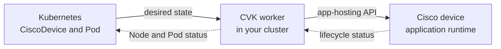

# How Cisco Virtual Kubelet works

Cisco Virtual Kubelet (CVK) connects Kubernetes with the app-hosting capabilities
of supported Cisco devices. A platform engineer describes an application in
Kubernetes; a CVK worker translates its lifecycle into actions on the device.
The application runs on the Cisco device. The worker runs in your cluster.

This overview describes the default per-device worker deployment. Start here
if you are evaluating the project or know one side of the integration better
than the other.

## Three objects to recognize

| Object | What it represents |
| --- | --- |
| **CiscoDevice** | A Kubernetes custom resource describing a device, its connection settings and credential references. |
| **Virtual Node** | The device's app-hosting capacity represented as a Kubernetes Node. |
| **Pod** | The desired application workload assigned to that Node. Its image must use a package and location supported by the device. |

You do not install a Kubernetes kubelet on the switch or router. CVK implements
the provider interface of the upstream [Virtual Kubelet](https://virtual-kubelet.io/)
project and communicates through the device's supported APIs.

## Follow an application

The manager creates a worker for each device. That worker registers the virtual
Node and keeps Kubernetes informed as applications change.

Scroll the diagram horizontally on smaller screens.
{ .cvk-diagram-hint }

1. **Connect a device.** Install the controller, configure device access, and
   create its `CiscoDevice` resource.
2. **Make the application available.** Stage a compatible application package
   or provide a supported download URL. A registry image name alone is not a
   device-ready package.
3. **Deploy and observe.** Assign a Pod to the device's virtual Node, then check
   Pod Events, worker logs and device app-hosting state.

The [getting-started guide](getting-started.md) walks through this sequence
with one device. [Image distribution](image-distribution.md) explains packaging
and delivery choices.

## Choose the capability you need

| Goal | Where to start | What to expect |
| --- | --- | --- |
| Run an application on a device | [Getting started](getting-started.md) | Device app hosting, with platform-specific packages and networking. |
| Use topology when placing applications | [Managed topology overview](topology-awareness.md) | Optional protected Node identity and labels, then native Kubernetes placement. |
| Declare supported device configuration | [Network as Code](netascode-config.md) | Intent resources, reconciliation and drift verification for supported model families. |
| Inspect device health | [Device diagnostics](device-diagnostics.md) and [Observability](observability.md) | Supported operations, device metrics, Events and telemetry. |
| Change the IOS-XE operating system | [IOS-XE maintenance runbook](gnoi-iosxe-upgrade-runbook.md) | A separate, explicitly enabled device-maintenance workflow. |

Application deployment and IOS-XE operating-system maintenance are separate
workflows. A software campaign uses operational custom resources; it is not an
application Pod or a prerequisite for deploying one.

## Know the boundaries

Platform capabilities differ. IOS-XE App-Hosting is the established path;
NX-OS app hosting and configuration are Beta. Managed topology is opt-in and
requires Kubernetes 1.35+ plus the documented admission and access controls.
Check [feature status](status.md) against the version you plan to install.

Kubernetes familiarity helps, but device-hosted workloads do not expose every
ordinary kubelet feature. Hosted-app logs, exec, attach and port-forward are
unsupported. CVK worker logs are available, and device metrics do not supply
per-Pod CPU/memory usage. Use the [API reference](API.md) and
[troubleshooting guide](troubleshooting.md) for the supported diagnostic paths.

## Continue from your starting point

- **Platform engineer:** [Install and deploy](getting-started.md), then
  [schedule application workloads](topology-scheduling.md) when topology is needed.
- **Network operator:** [Prepare your device](guides.md#prepare-a-device), then
  choose a [device operation](operator-guide.md).
- **Security reviewer:** review [credentials, trust and authorization](security.md).
- **Contributor:** read the [architecture and internals](ARCHITECTURE.md) and
  [contributing guide](https://github.com/cisco-open/cisco-virtual-kubelet/blob/main/CONTRIBUTING.md).
