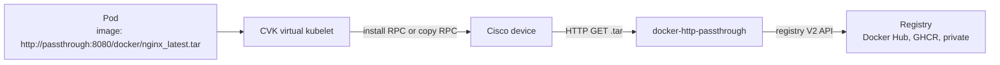

# Image Distribution

How to get a container image from a registry (Docker Hub, GHCR, a private
registry) onto a Cisco device managed by CVK.

## The problem

A pod's `image:` field is not a registry reference. CVK accepts:

- a **flash path** such as `flash:/virtual-kubelet/my-app.tar`, or
- an **HTTP(S) URL** that serves a Docker-save tar.

A value such as `nginx:latest` does not work. IOS-XE app hosting installs a
Docker-save tar, so something has to turn the registry image into a tar the
device can fetch.

## Options

| Option | How | Use when |
|---|---|---|
| Pre-stage on flash | Copy the tar to the device yourself, then `image: flash:/...` with `imagePullPolicy: Never` | Air-gapped devices, or one image deployed to a few devices |
| Any HTTP server | Host Docker-save tars on a web server and use the URL as `image:` | You already build and publish tars |
| [docker-http-passthrough](https://github.com/cisco-open/docker-http-passthrough) | An HTTP service that builds the tar on the fly from any registry V2 API (no Docker daemon) | You want to deploy images straight from Docker Hub, GHCR, or a private registry |

The rest of this page covers the third option. The first two need nothing
beyond [Image delivery](CONFIGURATION.md#image-delivery).

## How it fits



The **device** downloads the image. Either the device pulls the URL natively,
or, if that times out, the VK's copy RPC makes the device download it to
flash. The passthrough must therefore be reachable **from the device**. It
does not need to be reachable from the VK or from other cluster pods, and the
VK never fetches the tar itself.

## Run the passthrough

Follow the [project README](https://github.com/cisco-open/docker-http-passthrough#readme)
for running it with Docker, Docker Compose, or the `kubernetes.yaml`
manifest. This page does not repeat those instructions.

- Image: `ghcr.io/cisco-open/docker-http-passthrough` (linux/amd64 and linux/arm64)
- Listens on port `8080`; health check at `/health`

## Pod examples

Docker Hub image through the passthrough's default registry:

```yaml
spec:
  containers:
  - name: web
    image: http://passthrough.example.net:8080/docker/nginx_latest.tar
    imagePullPolicy: IfNotPresent
```

GHCR image, with the registry named in the URL (`my-org/my-app:1.2`):

```yaml
    image: http://passthrough.example.net:8080/registry/https/ghcr.io/docker/my-org__my-app_1.2.tar
```

Filename rules (full list in the
[passthrough README](https://github.com/cisco-open/docker-http-passthrough#image-filename-format)):

- The name must end in `.tar`.
- The **last** `_` separates the image path from the tag.
- `__` stands for `/` in the repository path.
- Tags that contain `_` cannot be represented.

## Credentials

| Where credentials live | Works with CVK? |
|---|---|
| Passthrough environment (`REGISTRY_USERNAME`, `REGISTRY_PASSWORD`, and so on) | **Recommended.** Pod URLs carry no secrets. |
| CVK `spec.imagePullSecrets` | Applies to the copy path only, as basic auth on the copy RPC URL. See [`imagePullSecrets`](CONFIGURATION.md#imagepullsecrets). |
| Passthrough client-auth routes (`/registry-auth/...`, `REGISTRY_CLIENT_AUTH`) with Cisco `ip http client username/password` | Device-side credentials. Combining them with `imagePullSecrets` is **not qualified**. |

Configure registry credentials on the passthrough and keep pod URLs
credential-free. The passthrough README documents the
[environment variables](https://github.com/cisco-open/docker-http-passthrough#private-registry-authentication).

## `imagePullPolicy` and timeouts

- `imagePullPolicy: Never` rejects HTTP URLs. Use `IfNotPresent` (default) or
  `Always`.
- The passthrough prepares all layers before it sends the first byte. A large
  image can therefore exceed the device-native pull wait (default 3 minutes)
  and trigger the copy fallback. Raise the wait with the
  `cisco.io/apphost-package-timeout` annotation; see
  [Pod annotations for the copy path](CONFIGURATION.md#pod-annotations-for-the-copy-path).
- When the native pull succeeds, no tar is kept on flash, so `IfNotPresent`
  re-downloads on every deploy. See
  [Image delivery](CONFIGURATION.md#imagepullpolicy).

## Limitations and security

- The payload is the **linux/amd64** image. Confirm that matches your device
  platform.
- The passthrough needs temporary disk space for the layers of each request.
- The examples use plain HTTP. Place the passthrough on a trusted network or
  front it with TLS.
- It fetches from whichever registry host the URL names. Do not expose the
  `/registry/...` routes openly.
- It holds registry credentials when you configure them in its environment.
  Protect it accordingly.

## Validation status

Validated with CVK on a Catalyst 9000.

<!-- TODO(confirm): IOS-XE release and route (/docker/ or /registry/...) used in the Catalyst 9000 test. -->

The passthrough project publishes its own
[validation table](https://github.com/cisco-open/docker-http-passthrough#validated-scenarios)
for Cisco app hosting.

## Troubleshooting

- [Pod stuck in `PullingImage`](troubleshooting.md#pod-stuck-in-pullingimage-waiting-state)
- [`IfNotPresent` still re-downloads](troubleshooting.md#imagepullpolicy-ifnotpresent-still-re-downloads-the-image-every-time)
- [`Never` with an HTTP image URL](troubleshooting.md#imagepullpolicy-never-with-http-image-url)
- [Kubernetes pod events](CONFIGURATION.md#kubernetes-pod-events) emitted during image delivery
- The passthrough's own [troubleshooting table](https://github.com/cisco-open/docker-http-passthrough#troubleshooting)
