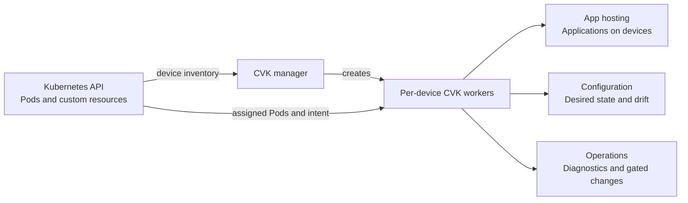

Documentation · Cisco Virtual Kubelet
{ .cvk-eyebrow }

# Deploy workloads on Cisco devices. { #welcome-to-cisco-virtual-kubelet }

Guides for platform experts deploying applications on supported Cisco devices
using familiar Kubernetes workflows. Start with device setup and app hosting.
{ .cvk-lead }

[Get started](getting-started.md){ .md-button .md-button--primary }
[Understand the basics](concepts.md){ .md-button }

**Documentation for v2026.11.0 · November 2026.** The
[Releases page](https://github.com/cisco-open/cisco-virtual-kubelet/releases)
determines publication status and artifact availability. Match your installed
version to the [feature availability](status.md) and upgrade guidance.
{ .cvk-version-note }

## Find your starting point { #what-it-does }

| If you want to… | Start here |
| --- | --- |
| Understand the project and its boundaries | [How CVK works](concepts.md) |
| Deploy an application on a Cisco device | [Getting started](getting-started.md) and [device setup](guides.md#prepare-a-device) |
| Configure, observe or maintain devices | [Guides](guides.md) and [Operations](operator-guide.md) |
| Review credentials, trust and access | [Security overview](security.md) |
| Extend the provider or a controller adapter | [Architecture](ARCHITECTURE.md) and [extension contract](controller-extension-guide.md) |

## Start with one device

-   **01 · Prepare**

    Choose your platform and configure its App-Hosting network.

    [Device setup guides](guides.md#prepare-a-device)

-   **02 · Connect**

    Install CVK, create a credential Secret, and declare a `CiscoDevice`.

    [Install and connect](getting-started.md#1-install-the-controller)

-   **03 · Run**

    Make your image available, deploy a pod, and verify it on the device.

    [Deploy an application](getting-started.md#4-deploy-a-pod)

## How it fits together { #concepts-at-a-glance }

CVK workers run in your Kubernetes cluster. Applications run on the device.
A `CiscoDevice` connects the two; its workers translate supported requests into
device actions.

Scroll the diagram horizontally on smaller screens.
{ .cvk-diagram-hint }

Platform capabilities differ. Software upgrades are IOS-XE-specific; external
controllers use separate adapter workers.
[Understand the components](concepts.md) or explore the
[technical architecture](ARCHITECTURE.md).

## Status

This documentation describes the `v2026.11.0` target. The [status page](status.md)
separates implemented capabilities, feature maturity and qualification limits.
Check [release records](releases/index.md) for publication and installed-version
context.

### Feature maturity

IOS-XE App-Hosting is Stable; NX-OS, configuration and telemetry are Beta.
Controller adapters and `IOSXESoftwareRollout` campaigns are Alpha. Managed topology
requires Kubernetes 1.35+ and separates app-hosting and network-management
ServiceAccounts. Write-class gNOI requires explicit opt-in. PDB-aware drain is
**disabled by default**, with no zero-downtime guarantee.
[Read the full maturity table and limits](status.md#feature-maturity).

## Reference and next steps { #where-to-next }

Find [resource fields and commands](reference/index.md), review the
[security model](security.md), or follow a [task guide](guides.md).
Development plans and qualification records have their own navigation section.

### Glossary

New to the terminology? The [glossary](glossary.md) explains Virtual Kubelet,
App-Hosting, Network as Code and device protocols.

### Release records { #what-is-new-for-october }

The [release archive](releases/index.md) distinguishes November preparation and
published artifacts from historical October notes, readiness records and dated
handoffs.

