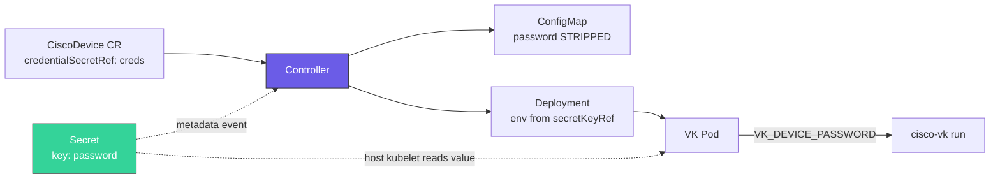

# Credentials and rotation

For platform installers creating device access and network operators rotating
it. Device credentials authenticate CVK to Cisco equipment; hosted-application
environment Secrets are a separate input delivered to the application.

Use one Secret per device unless the fleet deliberately shares a credential.
Create the Secret in the **device namespace**, not automatically the Helm
release namespace (`cvk-system` in the getting-started example). Give it the
exact key `password` and reference it with `credentialSecretRef`. Use the
[complete first-device manifest](getting-started.md) alongside the fragments
below. The expected result is a Ready worker with no literal device password
in its generated ConfigMap or Deployment environment.

| Task | Start here |
|---|---|
| Create a device credential | [Secret and reference](#recommended-secret-credentialsecretref) |
| Rotate one device or a shared fleet credential | [Single rotation](#rotating-a-single-password) or [bulk rotation](#bulk-rotation) |
| Deliver application secrets | [Hosted-application credentials](#hosted-application-credentials) |
| Delegate controller-intent secrets | [Administrator allow-list](security-authorization.md#controller-intent-secret-authorization) |

## Credential injection

With `credentialSecretRef`, the controller keeps device credentials out of the
`CiscoDevice`, generated ConfigMap, and literal Deployment environment values:

1. Before the `DeviceSpec` is marshalled into the ConfigMap, both `password` and `credentialSecretRef` are stripped.
2. The VK pod's Deployment gets `VK_DEVICE_PASSWORD` as an environment variable sourced from a Secret via `valueFrom.secretKeyRef`.
3. To roll the VK pod when credentials rotate, the manager watches referenced
   Secrets and reads their `resourceVersion`. The password-injection path does
   not inspect `.data`; however, the manager validates dedicated gNOI trust and
   provisioning Secret contents, including the signer when present. Typed
   Secret objects also enter its cache/API client. Treat the manager's Secret
   RBAC and memory as part of the credential trust boundary. Device certificate
   RPCs and signing of device-generated CSRs remain worker-owned.

Kubernetes Secret objects are still stored in etcd. Base64 encoding is not
encryption; enable Kubernetes
[encryption at rest](https://kubernetes.io/docs/tasks/administer-cluster/encrypt-data/)
and restrict Secret RBAC for production clusters.



### Recommended: Secret + `credentialSecretRef`

```yaml
apiVersion: v1
kind: Secret
metadata:
  name: cat9000-1-creds
  namespace: default
type: Opaque
stringData:
  password: <device-password>
```

```yaml
apiVersion: cisco.vk/v1alpha1
kind: CiscoDevice
metadata:
  name: cat9000-1
  namespace: default
spec:
  driver: XE
  address: "192.168.1.100"
  username: admin
  credentialSecretRef:
    name: cat9000-1-creds
  # ... remaining spec
```

**Rules:**

- The Secret **must be in the same namespace** as the `CiscoDevice`.
- The Secret key **must be named `password`** — this is hardcoded in the controller.
- Any Secret type works (`Opaque`, `kubernetes.io/basic-auth`, …) as long as it has a `password` key.
- Multiple `CiscoDevice`s can point at different Secrets — credentials are per-device.

### Legacy fallback: inline password

If `credentialSecretRef` is not set **and** `password` is non-empty, the controller injects it directly as an env var value (still scrubbed from the ConfigMap):

```yaml
spec:
  password: cisco123   # discouraged — only for dev/test
```

This remains for backward compatibility. The password is still visible in the `Deployment` spec (`kubectl get deploy -o yaml`), so Secret refs are strongly preferred in production.

### VK_DEVICE_PASSWORD precedence

The VK pod reads the device password from the `VK_DEVICE_PASSWORD` environment variable, which the controller injects on the Deployment it creates (sourced from the Secret referenced by `credentialSecretRef`). The password field in the rendered ConfigMap is always empty — the env var is the sole source of truth inside the pod.

### Rotating a single password

To rotate a device password without recreating the `CiscoDevice`:

```bash
# 1. Change the password on the device
# 2. Update the Secret
kubectl -n default patch secret cat9000-1-creds --type merge \
  -p '{"stringData":{"password":"new-password"}}'
# 3. The Secret watch updates the pod-template annotation and rolls the VK pod
kubectl -n default rollout status deploy/cat9000-1-vk
```

The controller maps a referenced Secret event back to every affected
`CiscoDevice` and places that Secret's current `resourceVersion` in the pod
template's `cisco.vk/credential-resource-version` annotation. A Secret update
therefore creates a Deployment rollout automatically; `cisco.vk/config-hash`
continues to cover ConfigMap changes. See [Managing credentials across multiple
devices → Bulk rotation](#bulk-rotation) for fleet-wide workflows.

### Managing credentials across multiple devices

Each `CiscoDevice` is independent: it declares its own `username` inline in the spec and points at its own Secret for the password. That means any combination of shared or distinct credentials is supported.

#### Pattern 1 — one Secret per device (different credentials)

The safest default. Every device gets its own Secret, even if the credentials happen to match today. A compromised or rotated password affects only one device.

```yaml
apiVersion: v1
kind: Secret
metadata:
  name: cat9000-edge-01-creds
  namespace: edge
stringData:
  password: <unique-password-1>
---
apiVersion: v1
kind: Secret
metadata:
  name: cat9000-edge-02-creds
  namespace: edge
stringData:
  password: <unique-password-2>
---
apiVersion: cisco.vk/v1alpha1
kind: CiscoDevice
metadata:
  name: cat9000-edge-01
  namespace: edge
spec:
  username: admin-edge-01
  credentialSecretRef:
    name: cat9000-edge-01-creds
  # ...
---
apiVersion: cisco.vk/v1alpha1
kind: CiscoDevice
metadata:
  name: cat9000-edge-02
  namespace: edge
spec:
  username: admin-edge-02
  credentialSecretRef:
    name: cat9000-edge-02-creds
  # ...
```

Rotate one device's password without touching any other.

#### Pattern 2 — shared Secret across a fleet (identical credentials)

When a group of devices share credentials (for example, lab devices behind the same TACACS/AAA profile), a single Secret can serve all of them. Each `CiscoDevice` references the same `credentialSecretRef`.

```yaml
apiVersion: v1
kind: Secret
metadata:
  name: lab-fleet-creds
  namespace: lab
stringData:
  password: <shared-password>
---
apiVersion: cisco.vk/v1alpha1
kind: CiscoDevice
metadata:
  name: lab-cat8kv-01
  namespace: lab
spec:
  username: admin       # same username across the fleet
  credentialSecretRef:
    name: lab-fleet-creds
  # ...
---
apiVersion: cisco.vk/v1alpha1
kind: CiscoDevice
metadata:
  name: lab-cat8kv-02
  namespace: lab
spec:
  username: admin
  credentialSecretRef:
    name: lab-fleet-creds   # same Secret as above
  # ...
```

Useful for bulk rotation — one Secret patch propagates to every device that references it. Trade-off: a compromised password affects the whole fleet.

#### Pattern 3 — same password, different usernames

Username is in the spec, not the Secret, so devices can share a password Secret while declaring different usernames.

```yaml
apiVersion: cisco.vk/v1alpha1
kind: CiscoDevice
metadata: { name: dev-01, namespace: dev }
spec:
  username: operator-a
  credentialSecretRef: { name: shared-creds }
---
apiVersion: cisco.vk/v1alpha1
kind: CiscoDevice
metadata: { name: dev-02, namespace: dev }
spec:
  username: operator-b
  credentialSecretRef: { name: shared-creds }
```

#### Namespace boundaries

The Secret **must be in the same namespace** as the `CiscoDevice`. Kubernetes' own kubelet on the real node hosting the worker resolves `secretKeyRef` at Pod start. This reference has no namespace field and cannot select another namespace's Secret.

That reference restriction does not constrain the manager's or worker's API permissions. The manager can read Secrets cluster-wide, and functional app-hosting workers inherit cluster-wide Secret reads. Tenant RBAC must separately limit human and automation access; namespace placement alone does not isolate Secrets from a compromised app-hosting worker. Review the [authorization boundary](security-authorization.md#production-rbac-hardening) before choosing a shared cluster.

If you want the same password in two namespaces, duplicate the Secret (ideally managed by External Secrets Operator, Sealed Secrets, or your GitOps tooling).

#### Bulk rotation

| Scenario | Approach |
|---|---|
| Rotate one device | Patch its Secret; the controller automatically rolls the referencing VK Deployment. Verify with `kubectl -n <device-namespace> rollout status deploy/<device>-vk`; inspect both worker planes when managed topology is enabled. |
| Rotate a shared Secret (Pattern 2) | Patch it once; the Secret watch reconciles and rolls every referencing VK Deployment in that namespace. |
| Rotate the whole namespace | Update each Secret; wait for the affected Deployments to complete their automatic rollouts. |

If the automatic rollout does not begin, confirm that the manager is healthy,
the `CiscoDevice` still references the updated same-namespace Secret, and the
Deployment's `cisco.vk/credential-resource-version` matches the Secret's
`metadata.resourceVersion`. A manual `kubectl rollout restart` is a
troubleshooting fallback, not the normal rotation path.

#### GitOps and external secret managers

The `credentialSecretRef` field takes a reference to any Kubernetes `Secret`, regardless of how it was created. Common workflows:

- **Sealed Secrets** — commit encrypted Secrets to Git; controller in the cluster decrypts them into real Secrets.
- **External Secrets Operator** — point at HashiCorp Vault, AWS Secrets Manager, Azure Key Vault, GCP Secret Manager, etc.; ESO syncs them into Kubernetes Secrets.
- **SOPS / git-crypt** — encrypted manifests in Git, decrypted on apply.

All of these produce a normal `Secret` resource with a `password` key, which is what `credentialSecretRef` needs. No change to CiscoDevice is required.

## Hosted-application credentials

Environment values sourced through `SecretKeyRef` are resolved by the VK and
delivered to the hosted application as Docker run options. They are therefore
also visible to an administrator with permission to inspect app-hosting
configuration on the device. Grant pod-creation and device-administration
rights accordingly.

Environment-variable names must use the portable
`[A-Za-z_][A-Za-z0-9_]*` form. Although newer Kubernetes API validation admits
a broader printable character set, CVK rejects those relaxed names before
device access because IOS XE and NX-OS both render names into Docker run
options. Rename variables containing dashes, dots, spaces, or other punctuation
before deploying them through CVK.

CVK does not include resolved run options in controller logs or reconciliation
errors. The IOS XE app-hosting RESTCONF client and the NX-OS NX-API client also
reject HTTP redirects and omit free-form device response text from errors where
it could echo app-hosting data. Length-validation errors report only the
measured and supported sizes. IOS XE image-copy logging strips URL user
information, query parameters, and fragments while still sending the original
authenticated source to the device.


NX-OS environment values are likewise validated before CLI rendering. The
current transport accepts printable ASCII values except semicolons, pipes,
quotes, backslashes, and backticks; it also rejects control characters and
non-ASCII text. JSON documents, PEM blocks, generated passwords, or other
values containing those characters must be delivered to the application by a
different mechanism until an NX-OS-native quoting strategy is validated.


For IOS-XE source support, single-quote handling and RunOpts size limits, use
[Environment variables](environment-variables.md). For image-path validation,
see [Hosted application image input](security-tls.md#hosted-application-image-input).

## Verify the credential change

The referenced Secret and `CiscoDevice` must share a namespace. After rotation,
the affected worker Deployment must complete its rollout and report the new
`cisco.vk/credential-resource-version`; device connection and readiness should
recover. Inspect both app-hosting and network-management workers when using
managed topology. Use the [namespace-aware troubleshooting sequence](troubleshooting.md#first-gather-the-basics)
without printing Secret values.

Next, configure [TLS and transport trust](security-tls.md) and review the
[worker identities](security-authorization.md). Return to the [security overview](security.md).
