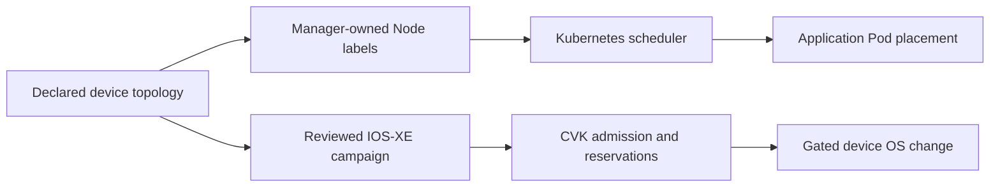

# Managed topology and IOS-XE software campaigns { #managed-topology-and-topology-aware-ios-xe-rollouts }

Managed topology connects administrator-declared device locations to two separate
workflows: placing application Pods and coordinating IOS-XE operating-system
changes. Start with the task you need; enabling placement does not authorize an
OS upgrade.

Scroll the diagram horizontally on smaller screens.
{ .cvk-diagram-hint }

## Choose a task

| I want to… | Start here |
| --- | --- |
| Enable the managed boundary and enroll devices | [Enable and enroll](topology-enable.md) |
| Place applications by site, rack or failure domain | [Schedule application workloads](topology-scheduling.md) |
| Plan, approve and run an IOS-XE upgrade or downgrade | [Run software campaigns](topology-campaigns.md) |
| Evaluate voluntary workload evacuation before a campaign | [PDB-aware drain preview](topology-drain.md) |
| Understand blocked work and inspect current evidence | [Observe and troubleshoot](topology-troubleshooting.md) |
| Recover work, retire topology or transfer device ownership | [Recovery and retirement](topology-recovery.md) |
| Inspect authority, protocol and qualification contracts | [Design and authorization reference](topology-reference.md) |

## Before you begin

Managed topology is disabled by default. It requires Kubernetes 1.35+, native
admission, administrator-controlled device namespaces, leader election and matching
chart/CRDs/manager/workers. Complete the [setup prerequisites](topology-enable.md#prerequisites)
before enrollment; a ready Pod alone does not prove that boundary.

Application hosting can use the initial network-observer profile. OS campaigns
additionally require network read-write authority and explicit upgrade gates.
Follow the [campaign procedure](topology-campaigns.md), not unmarked per-device
upgrade leaves, for enrolled devices.

## Scope and qualification

These pages target `v2026.11.1`. October `v2026.10.0` contains the foundation;
November introduces the staged activation, recovery and network-evidence
extensions described here. Upgrade the matching CRDs, admission policies,
chart, manager and workers together. Check [release records](releases/index.md)
for publication status and [feature status](status.md) for qualification limits.

Campaigns are IOS-XE-specific. Default `BlockIfRunning` blocks on live workloads;
optional drain has a narrow cohort and incomplete service-through-reload
qualification. A heartbeat, graph or successful lab run does not prove production
forwarding health. Keep guards until the relevant cluster, device and application
checks pass.

[Recorded scope and evidence](topology-merge-scope.md) identifies the tested
boundaries. The [roadmap](topology-roadmap.md) and
[execution plan](topology-roadmap-execution.md) retain development history, not
authority to bypass a blocked operation.

Links from earlier versions of this guide

Older links remain valid below. Each opens the corresponding task or reference
section; update bookmarks to its canonical page when convenient.

| Previous section | Continue to |
| --- | --- |
| Architecture and ownership | [Open section](topology-reference.md#architecture-and-ownership) |
| Prerequisites | [Open section](topology-enable.md#prerequisites) |
| Configure and enable | [Open section](topology-enable.md#configure-and-enable) |
| Label vocabulary | [Open section](topology-enable.md#label-vocabulary) |
| Enroll devices safely | [Open section](topology-enable.md#enroll-devices-safely) |
| Workload scheduling | [Open section](topology-scheduling.md#workload-scheduling) |
| Experimental in-tree Workload/PodGroup/TAS | [Open section](topology-reference.md#experimental-in-tree-workloadpodgrouptas) |
| Topology-aware IOS-XE software campaigns | [Open section](topology-campaigns.md#topology-aware-ios-xe-software-campaigns) |
| Secure gNOI and image-source prerequisites | [Open section](topology-campaigns.md#secure-gnoi-and-image-source-prerequisites) |
| Opt-in PDB-aware drain (development preview) | [Open section](topology-drain.md#opt-in-pdb-aware-drain-development-preview) |
| Submit, review, and approve | [Open section](topology-campaigns.md#submit-review-and-approve) |
| Admission and execution behavior | [Open section](topology-campaigns.md#admission-and-execution-behavior) |
| Pause, resume, and cancel | [Open section](topology-campaigns.md#pause-resume-and-cancel) |
| Observe and troubleshoot | [Open section](topology-troubleshooting.md#observe-and-troubleshoot) |
| Delegated authorization | [Open section](topology-reference.md#delegated-authorization) |
| Rollback and retirement | [Open section](topology-recovery.md#rollback-and-retirement) |
| Abandoning an unused preparation | [Open section](topology-recovery.md#abandoning-an-unused-preparation) |
| Offline transfer to another cluster | [Open section](topology-recovery.md#offline-transfer-to-another-cluster) |
| Qualification checks | [Open section](topology-enable.md#qualification-checks) |
| Read-only accepted topology graph | [Open section](topology-troubleshooting.md#read-only-accepted-topology-graph) |
| Deferred roadmap and limitations | [Open section](topology-reference.md#deferred-roadmap-and-limitations) |

