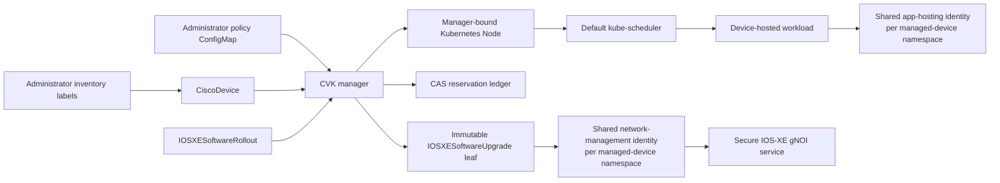

# Managed topology design and authorization reference

**For platform administrators, reviewers and contributors.** This page preserves
the detailed ownership, admission, state and qualification contracts. For a task,
start from the [topology overview](topology-awareness.md); executable setup,
approval, drain and recovery procedures keep their required checks alongside them.

## Architecture and ownership



The ownership split is strict:

| Surface | Authority |
| --- | --- |
| Desired stable topology and operational risk domains | protected `CiscoDevice.metadata.labels` |
| Stable physical chassis identity used for deduplication | write-once operator-declared `CiscoDevice.spec.physicalIdentity` |
| Node name, UID binding, projected labels, static/maintenance taints | manager |
| Node and Pod status, app execution | app-hosting read-write identity; native admission binds each write to a manager-owned Node/Pod relationship |
| Pod placement | default kube-scheduler |
| Fleet plan, policy evaluation, reservations, child admission | manager |
| Configuration, image transfer/install/activate/verify, limited rollback | network-management identity selected as read-write |

The manager never opens a device session. The worker never chooses fleet
policy. A rollout is not represented as a Pod or Job because scheduler retries
cannot provide at-most-once device-mutation claims or domain reservations.

The physical chassis identity is deliberately operator-declared, write-once,
and manager-deduplicated case-insensitively. Its lowercase canonical value is
recorded in the immutable Node-identity status. A per-device worker supplies live device inventory,
Node health, and execution observations, so compromise of that worker can
falsify those observations. It cannot rewrite the declared physical identity,
protected topology, policy, or ledger authority. Treat worker evidence as a
freshness and consistency signal, not as the root identity assertion.

Managed topology defines exactly two reusable functional ServiceAccount
identities in each namespace that contains managed CiscoDevices, regardless of
device count: one for app hosting and one for network management. These are not
cluster-global accounts because Kubernetes ServiceAccounts are namespaced, and
they are never multiplied per device. Each identity selects exactly one of
`disabled`, `readOnly`, or `readWrite`; `disabled` removes that account, its
bindings, and its worker plane, so a namespace with a disabled plane
materializes fewer than two accounts. App-hosting read-only is a
delegated Kubernetes observation identity only—the manager does not create an
app worker, the Node remains guarded from scheduling, and app hosting is
unavailable. App-hosting read-write runs the virtual-kubelet path. Network
read-only runs telemetry, diagnostics, and read-only operations; network
read-write additionally permits configuration and explicitly enabled gNOI
mutation reconcilers. Runtime gates mirror RBAC so read-only never means
"mutate the device and then fail to report status."

Topology-disabled mode retains the historical combined
`cisco-virtual-kubelet` ServiceAccount. During upgrade, an existing combined
or per-device identity is a keep-protected migration bridge only. A fresh
managed install does not create that third account, and the manager retires
old identities after their workloads are quiesced and both replacement planes
have passed their profile audit.

For a selected managed device, the manager also content-addresses the complete
desired worker PodTemplate, excluding only the revision's own annotation and
environment carrier. Credential, gNOI TLS, and provisioning Secret
resourceVersions are PodTemplate inputs, but Secret bytes never enter the
hash. The digest is injected as
`CISCO_VK_WORKER_CONFIG_REVISION`; the running worker returns it through its
status-only Node writer. `CiscoDevice.status.workerRevision` becomes ready only
after the exact owned Deployment completes, exactly one non-terminating owned
Pod is Ready, and that Pod publishes a matching heartbeat after its start
time. A Secret rotation therefore blocks new gNOI campaign admission until the
`Recreate` worker rollout proves that the new process loaded the new inputs.

## Managed-profile validation

The `maxPods` bound is a managed-topology scheduling invariant. Standalone
mode deliberately keeps its historical compatibility behavior: values at or
below zero fall back to 16, and otherwise the existing `int32` value is used.

The default VK role name remains a migration invariant for retiring the
topology-disabled combined identity. Steady-state managed workers instead use
the account names under `topology.workerAccounts`; the manager may bind only
the four fixed functional profiles and the fixed, non-selectable app-read,
network-global-read, and Lease-only support roles. A distinct
`CONFIG_LEASE_NAMESPACE` receives only the matching Lease support role, never
the tenant network profile.

The manager checks API discovery, policy generation, binding shape, contract
version, built-in-resource expression warnings, and the exact live rule sets
of the fixed functional worker and support ClusterRoles before enabling managed workers. It
rejects role aggregation or any additional resource or verb. Each worker then
performs positive and negative server-side dry runs with its own credentials: a
harmless Node-status write must succeed, while a label write smuggled through
`/status` must be denied. A version check or an empty warning list alone is not
proof that admission works.

Helm may apply the manager's narrowly scoped `get`/`bind` grant before admission
because those are independent Kubernetes objects. No worker completion binding
is rendered by Helm, and controller startup remains blocked until both policy
and role attestations pass. The Helm actor and controller ServiceAccount are
therefore trusted computing-base identities during this reconciliation window;
protect them from compromise and concurrent out-of-band RBAC mutation.

Node authorization is necessary but does not turn the functional worker token
into a `system:node:*` credential. App read-write still has the documented
cluster-wide workload-input reads required by upstream virtual-kubelet. Treat
the native Node authorizer and NodeRestriction as prerequisites for the real
kubelet that requests projected tokens, not as a substitute for the shared
worker admission policies or the locked namespace boundary.

## Delegated authorization

The chart creates these ClusterRoles but binds none of them:

| Role suffix | Delegated action |
| --- | --- |
| `-topology-author` | change protected topology/risk labels and adoption/reclassification approvals |
| `-rollout-planner` | create campaigns and issue monotonic pause/resume/cancel controls |
| `-rollout-approver` | approve one exact frozen-plan hash |
| `-rollout-activator` | separately authorize activation bound to the frozen plan and preparation receipts |
| `-rollout-recoverer` | request the narrowly verified invalidation of eligible unused preparation receipts |
| `-topology-policy-admin` | change coherent policy content, not its ledger UID binding |
| `-topology-ledger-breakglass` | exceptional ledger recovery; normally unbound |

Use namespace RoleBindings and keep planner, approver, policy administrator,
and ledger recovery identities separate where separation of duties is
required. Kubernetes RBAC cannot constrain an arbitrary label selector's
result; the manager therefore applies the administrator fleet selector,
same-namespace rule, explicit `allowAll`, target cap, frozen target UIDs, and
exact-hash approval as additional authority boundaries.

Managed worker RBAC exposes four selectable roles. The manager binds the app
account to exactly one app role and the network account to exactly one network
role; it never stacks read-only and read-write. The app read-write role has no
Node metadata/spec, generic Pod update/create, Pod log/exec, Lease create/delete,
RBAC, token, or Secret write authority. Its CiscoDevice and operation-risk
reads come from an implementation-only namespaced support role, never its
cluster-bound profile. Both running planes may create a
`SelfSubjectReview` to verify their Pod-bound token identity. The network roles
are namespaced; only the non-selectable global-read support role supplies
cluster-scoped reads. Network read-write has no Node/Pod mutation, RBAC, token,
or cluster-wide Secret grant.
Its bounded upgrade/action main/status verbs are stable so two Helm releases
cannot race to redefine a cluster-shared profile. The explicit runtime gate
still decides whether each mutation controller is registered, and native
admission independently enforces operation ownership and protocol.

Admission also reserves the two functional ServiceAccount objects to the
manager, permits their TokenRequest subresource only to a kubelet for an exact
Pod-bound token, and denies legacy ServiceAccount-token Secrets. This closes
the otherwise-valid path where another token-issuing principal could reuse the
shared username without the manager-bound worker Pod incarnation.

Network worker names use the full immutable CiscoDevice UID before the
generated suffix (`u<device-uid>-network-...`), independently of the device
name length. This keeps the identity intact when Kubernetes truncates
generated Pod names. The UID-first naming transition rotates prior worker
accounts through the existing policy-epoch settlement and cleanup sequence;
it does not run old and replacement network workers concurrently.

At startup, the manager derives one worker-account policy epoch from every
verified admission contract that protects reusable worker credentials: shared
and generated ServiceAccount ownership, bound TokenRequest issuance, legacy
ServiceAccount-token Secret prevention, and reserved Deployment, ReplicaSet,
Pod, and Pod-update behavior. The epoch hashes each policy and binding UID,
generation, and compiled Spec digest; `resourceVersion`, labels, and annotations
are intentionally excluded. Every shared and generated worker ServiceAccount
is stamped with that epoch. An account created before this boundary—or under an
older contract—is never adopted: the manager revokes its exact bindings first,
deletes the old ServiceAccount to invalidate every token tied to its UID,
foreground-drains workloads using it, and only then creates the replacement.
This one-time guarded migration also invalidates a legacy JWT whose
immutable-type ServiceAccount-token Secret had its mutable ServiceAccount name
and UID annotations changed to a different existing, non-reserved account.
Legacy authentication uses the signed claims and token bytes rather than those
mutable annotations; UID rotation invalidates the claimed old ServiceAccount
directly.
For a normal chart-policy epoch change, the network-management account is not
rotated until every device in the namespace has settled its mutation Lease,
maintenance session, admitted software-upgrade leaf, and rollout reservation.
The independent app-hosting account completes UID rotation, RBAC regrant, and
Deployment recreation without waiting on an unrelated network mutation; the
blocked network account and workload remain unchanged. Generated per-device identities use the same per-device
authority-settlement proof before an epoch-only rotation. A phase-zero legacy
worker has no durable managed Node identity for the complete proof, so the
manager preserves its old UID and running workload and reports a blocker; after
the operator verifies device operations are idle and removes that workload, the
manager performs the UID rotation. The transition reports the blocking object
and retries, so an upgrade does not silently interrupt an active gNOI or
configuration mutation. A concrete compromise signal—unsafe namespace RBAC,
malformed generated workload/access, or an explicitly attributable legacy
token Secret—takes the fail-closed quarantine path immediately instead of
waiting.

Shared-account quarantine is authority-first and does not trust deterministic
RoleBinding names. It removes every namespaced RoleBinding whose exact subject
is the reserved account in both the device and configured Lease namespaces,
removes the known cluster-wide grants, deletes each exact-proven shared
ServiceAccount with a UID precondition to invalidate minted tokens, and then
terminates every workload using that account. Foreign objects that merely
collide with a reserved name are retained and reported. Direct API reads
repeat the binding audit after access is installed; a grant racing the initial
audit triggers the same synchronous quarantine before reconcile returns.
The manager can delete a reserved worker Pod only with its exact UID as a
precondition. Admission denies its direct deletion of ordinary application
Pods, including when a UID is supplied; quarantine does not grant a workload
deletion or PodDisruptionBudget bypass.
Native garbage collection can remove only its `foregroundDeletion` finalizer
from already-deleting reserved worker objects, preserving spec, status,
bindings and unrelated finalizers. This permits a foreground worker-identity
rotation to finish without administrator finalizer repair.
Generated-account compromise uses the same authority-first rule inside the
device namespace: every RoleBinding with the exact UID-derived account subject
is removed regardless of its name, role, or mutable metadata before the owned
ServiceAccount UID is deleted. Foreign or arbitrary cluster-wide bindings stay
inside the explicit cluster-admin trust boundary and keep reconciliation
failed closed for operator review.

Native Kubernetes node lifecycle reconciliation remains enabled: the exact
node-controller identity can mark silent Nodes `Unknown`, reconcile built-in
health taints, and synchronize the deprecated OS/architecture label aliases.
It cannot publish healthy readiness, rewrite projected topology or worker
bindings, remove CVK maintenance guards, change capacity, or clear a cordon.
This keeps stale virtual Nodes out of ordinary scheduling without assigning
CVK identity authority to a native controller.

The manager pre-creates purpose-bound heartbeat, config-family, and mutation
Leases. App read-write and network read-write may update only the Lease scopes
they need; read-only network management can observe but not mutate them.
Admission checks the manager-owned device/Node/Pod bindings on each write,
rather than deriving authority from a per-device username.

Shared identities deliberately move the residual blast radius from one device
to one tenant namespace. The app read-write account still needs cluster-wide
Pod and workload-input reads because a virtual Node can receive Pods from any
namespace; Kubernetes RBAC cannot limit Secret reads to dynamically referenced
Pod inputs. A compromised worker can also attempt peer writes under the same
account, so fail-closed admission—not process filtering—must enforce object
binding. This is not equivalent to Node Authorizer/NodeRestriction. Use
separate namespaces for mutually untrusted fleets, audit every profile binding,
and treat app-hosting workers as cluster-trusted workloads until node-scoped
credentials or manager-mediated status are qualified. Because upstream
`nodeutil` constructs cluster-wide Pod, Secret, ConfigMap, and Service
informers, functional app hosting should run only in a dedicated trusted
workload cluster, or where every workload namespace accepts the same
Secret-read trust boundary. A compromised app read-write worker exposes those
cluster-wide reads; namespace separation cannot contain them.

## Policy and plan transitions

The [approval patch](topology-campaigns.md#submit-review-and-approve) must use the
authenticated approver identity; admission rejects an asserted different username.
Once published, the optional `status.frozenPlan` parent
cannot be removed and re-added or replaced; API-server transition validation
enforces this even for manager-authenticated status writes. Policy updates are
classified rather than treating every
ConfigMap `resourceVersion` as executable drift:

- metadata-only or canonically equivalent rewrites update the recorded audit
  resourceVersion without changing the active safety epoch;
- compatible numeric changes start a durable next epoch. The effective target
  cap, fleet/domain transfer and unavailable ceilings, health-freshness limit,
  active-reservation cap, and ledger-size cap are the minimum of the frozen,
  previously effective, and current values, so an existing rollout can never
  be loosened by a policy edit; and
- changing policy/ledger identity, policy version, selector, required or
  projected topology-key sets, domain-key, risk-group or optional-budget shape, or setting
  `maxCampaignTargets` below the frozen target count sets
  `PolicyChanged=True` with `Reason=ReplanRequired` and requires a new rollout.

During an epoch transition the campaign pauses and publishes a durable
`status.policyTransition` before revoking any unclaimed authority. Zero-claim
leaves release their old reservations and may be rearmed only after the new
`status.effectivePolicy.epoch` is published. The manager admission, worker
acknowledgement, reservation, and every mutation claim all carry that exact
epoch. Pending and granted manager admission also carries the exact
32-character topology-lock acquisition ID shared with the reservation and
device lock. A stale cleanup or worker grant therefore cannot target a later
acquisition that happens to reuse a reservation name. A claimed mutation is
never rearmed or abandoned by a policy change.

The frozen target also binds the CiscoDevice UID and `metadata.generation`;
any CiscoDevice spec change, including its driver, management address/port, or
trust-reference selection, requires re-planning and re-approval. In-place data
rotation of an already bound Secret keeps the same Secret UID and is allowed
only after purpose, endpoint, and trust checks pass again. Delete/recreate
Secret replacement is not allowed under the old plan. Granted work that the
worker has not claimed is revoked and its reservation is released.
Already-claimed work keeps its reservation and is observed to a conclusive
outcome; policy or target drift never silently expands or abandons existing
mutation authority.

## Campaign protocol versions

Managed preparation and receipt-bound activation use
`rollout-staged-activation-v1`, which also enforces pacing when configured.
Network-enabled campaigns freeze `requireNetworkEvidence: true` in their
immutable leaves. Non-staged network leaves use `rollout-network-evidence-v1`;
staged network leaves use the staged protocol. Both require the exact fresh
network evidence at each mutation claim; missing evidence cannot silently
disable that gate. Older workers reject these new protocols.

## Health and reservation evidence

Health freshness is manager-authenticated rather than inferred from whichever
status field changed most recently. The manager writes
`CiscoDevice.status.healthObservation` with its observation time, the exact
bound Node `Ready` heartbeat time, and a SHA-256 hash of the current device
phase and complete condition set. Planning, admission, and post-operation
settlement re-read both live objects. The device-condition hash must still
match. The live Node must remain `Ready=True`, its heartbeat cannot regress,
and its nonzero Ready transition time cannot be later than the snapshotted
heartbeat. A later live heartbeat with that unchanged transition proof is
treated only as informer/API read skew: the authenticated snapshot heartbeat,
not the newer live value, remains the freshness bound. The effective health
time is the oldest of the manager observation, snapshotted Node heartbeat, and
required condition-producer observations (and is capped at current time), so
refreshing one source cannot make older evidence fresh and a future-dated
heartbeat cannot extend authority. A device phase/condition hash change,
non-True Node Ready state, heartbeat regression, or Ready transition after the
snapshot invalidates the proof until the manager records a new snapshot; the
post-operation gate additionally requires that authenticated time to be
strictly later than leaf completion.

The first Node binding deliberately leaves `healthObservation` absent; identity
creation is not health evidence. Each fixed readiness condition also requires
an explicit, current manager producer observation. For those CiscoDevice
conditions, the controller does not fall back to `lastTransitionTime`, because
an old transition can remain unchanged while its external evidence becomes
stale or unavailable. Node Ready `lastTransitionTime` is used only to prove
state continuity across heartbeat skew, never as producer or freshness time.
`GNOIConfigurationReady=True` additionally requires the manager-owned worker
revision proof above. Deployment availability alone is insufficient: during a
Secret-driven `Recreate`, an old Pod or a heartbeat that predates the new Pod
cannot authorize gNOI work.

The single ConfigMap ledger is updated with resourceVersion compare-and-swap.
It is bounded to 256 records and 256 KiB by default. Combined install/activate
leaves conservatively hold transfer and disruption reservations through the
leaf. Source locality alone is not an independent prefetch boundary; staged
preparation separately retains its receipt-bound device ownership. A Lease expiry never settles an accepted device mutation.

Both combined and network-only workers select strict inventory through the
driver's explicit `DrainPodInventoryProvider` capability. The ordinary
`ListPods` reader is never substituted for this complete scan; a missing
capability or a partial-inventory error blocks a new device mutation.

## Drain state and recovery contract

Use the [drain procedure](topology-drain.md) for eligibility, opt-in configuration,
operator controls and cleanup. These internals explain why an uncertain state
must remain fenced; they are not instructions to manipulate status or Leases.

The durable flow is deliberately serial and revalidates identity at every
boundary:

1. The manager freezes exact Pod, ReplicaSet/Deployment, PDB, Node, policy,
   reservation, and worker identities under a new UUIDv4 drain session.
2. The manager snapshots pre-existing scheduling state, applies a
   session-owned cordon plus
   `cisco.vk/device-maintenance=gnoi:NoSchedule`, activates the existing
   maintenance session, and blocks ordinary device writes.
3. The manager atomically adds its drain-session marker and one protected
   finalizer to one exact Pod UID, revalidates its evidence, and asks the
   Eviction subresource to terminate it. No second selected Pod is evicted
   until the first controller has observed its current generation and returned
   to exactly its desired total replicas. A Deployment must report every desired
   replica updated, Ready, and available with zero unavailable; a direct
   ReplicaSet must report every desired replica Ready and available.
4. Only the selected Pod's provider teardown may acquire the ordinary
   device-mutation Lease as `software-drain/<leaf UID>`. After teardown, the
   worker performs a fresh, complete device workload inventory. On IOS-XE,
   both the app-hosting configuration and operational inventories must be
   readable and every app must have a consistent CVK workload identity; a
   partial, malformed, or unattributed result fails closed. During active drain
   the manager requires no foreign or unknown device workload. During terminal
   recovery, an attributable replacement may already have returned to the
   restored Node; a complete scan may therefore contain non-selected UIDs but
   must still prove the exact selected UID absent and report zero unknowns.
   A cache-lagged provider callback is resolved against the uncached live Pod;
   an exact-UID mismatch fails closed. The worker reauthorizes the session
   immediately before device dispatch and before every Lease renewal. Once the
   manager has durably accepted `DeviceClean`, verified the canonical Lease is
   idle, and removed its exact marker/finalizer, a later provider callback is a
   completion acknowledgement only: it performs no driver call, inventory,
   Lease operation, or Kubernetes write. Upstream Virtual Kubelet then performs
   its existing exact-UID, zero-grace API deletion. The provider accepts this
   narrow path from `DeviceClean` (the crash boundary before the manager records
   `Released`) or `Released`, only with ordered accepted-Eviction, termination,
   and positive newer inventory evidence plus a still-idle, request-free exact
   Lease. A recovery-only `Protected` to `Released` transition without device-
   clean evidence never qualifies. The worker logs
   `managed drain device-clean completion acknowledged without device mutation`
   at this boundary before upstream Virtual Kubelet completes the API deletion.
5. After every selected Pod is complete, the manager proves that no new Pod is
   bound to the guarded Node, the mutation Lease is idle and request-free, and
   all frozen campaign/source/target/control facts still match. Only then does
   it promote the reservation and maintenance session to disruptive gNOI
   software mutation.
6. Once the device outcome is conclusive, recovery restores only the cordon
   and taint owned by this session, permits normal workload writes, and waits
   for the exact controller and PDB UIDs, their current drain-safe templates,
   selectors and healthy observed generations, post-mutation device/Node health,
   and continuous soak. The topology reservation remains held through this
   recovery and is settled last.

Include failed-write quarantine and native Virtual Kubelet queue backoff in
the maintenance window. An uncertain app lifecycle operation can retain the
canonical mutation Lease for 31 minutes after its last renewal; expiry does
not immediately schedule another attempt. A replacement that cannot become
healthy prevents the next eviction and gNOI promotion. Do not clear the Lease
or change Pod metadata merely to force a retry. The IOS-XE lifecycle wait
defaults to 180 seconds per state; a shorter
`cisco.io/apphost-package-timeout` override can turn a slow transition into a
failed write and a much longer recovery wait.

The leaf's durable manager states are `Preparing`, `Guarded`, `Evicting`,
`Drained`, `Promoting`, `Promoted`, `Recovering`, and `Settled`. Each selected
Pod advances through `Selected`, `Protected`, `EvictionRequested`,
`TerminationObserved`, `DeviceClean`, `Released`, and `Complete`. Treat these
as current evidence, not commands to patch manually. Manager and worker status
ownership, immutable identity fields, Pod marker/finalizer pairing, Lease
purpose, and monotonic transitions are protected by CRD validation and native
admission.

A control renewal also cannot silently carry an old Lease request into its new
window. If the canonical Lease is still held under the preceding recovery
revision, the provider returns a mutation-incomplete result, neither renews the
old revision nor dispatches another device call, and leaves the hold quarantined
through the exact `renewTime + leaseDurationSeconds` boundary. Only then may it
retire the exact same Lease UID, session, operation, and holder when the request
metadata is either complete and bound to that strictly older revision or wholly
absent from a crash before publication. Partial, malformed, foreign, or
unexpired state remains blocked for investigation. Retirement preserves the
transition counter and performs no device call. On a later reconcile, cleanup
must first obtain a fresh current-revision CiscoDevice maintenance-session
acknowledgement before the provider can reacquire the Lease and resume
already-accepted teardown. The 31-minute Lease TTL can outlast a recovery
window, so an operator may need another explicit bounded renewal while waiting.
Neither Lease expiry nor safe retirement is device-clean evidence.

Worker replacement never makes old device-clean evidence current by itself.
The provider binds drain authorization to the immutable configuration revision
of its own running process, `status.workerControl`, the protected Node's
`topology.cisco.vk/worker-observed-revision`, and the manager-authenticated
Deployment/revision/exact-Pod readiness proof in
`CiscoDevice.status.workerRevision`. If device-clean evidence is still needed
after a credential, trust, or PodTemplate rotation,
the replacement worker must perform and publish a strictly newer device
inventory. The worker-drain inventory
revision and both observation timestamps advance together with
`observedWorkerConfigRevision`. Admission permits that rollover but rejects a
stale process, a rewritten same-revision observation, and any manager attempt
to consume inventory whose worker revision does not match the current control
acknowledgement.

After the manager has already persisted `DeviceClean`, that manager-owned
record is the durable acceptance fence. Finishing deletion of the same
terminating Pod UID does not require the worker that produced the inventory to
remain alive, the drain deadline to remain open, or mutation-only scheduling
guards to remain applied. This exception grants no device access: it requires
the exact session/leaf/Pod identities, absent manager protection, ordered
device-clean evidence, and a wholly idle request-free canonical Lease. It is
what makes the final Kubernetes deletion restart-safe during worker rollout and
drain recovery.

The manager-side Eviction/PDB, identity, reservation, and recovery mechanics
are deliberately above the IOS-XE driver. A future NX-OS or IOS XR adapter can
reuse them only after it implements exact session-authorized device teardown,
complete post-teardown device workload inventory, and a lifecycle with equally
strong mutation/outcome guarantees. No current non-IOS-XE driver gains drain
or software-rollout support from this gate, and the public API remains IOS-XE
specific until a second qualified driver proves the common contract.

## Reverse-handoff state contract

Use the [retirement procedure](topology-recovery.md) for permissions, exact object
checks and the supported live Helm transition.

The reverse handoff is durable and fail closed: `Preparing` records the
authorized immutable identity, `LegacyWriterPending` records that managed API
authority is revoked and Node release is durably authorized,
`SharedWriterPending` records that the temporary UID-scoped worker proved a
post-release heartbeat and is being replaced under `Recreate`, and `Complete`
is published only after the configured namespace-shared compatibility worker
proves a newer Ready heartbeat and the temporary ServiceAccount and bindings
are deleted. The per-device identity is therefore transition-only; in managed
steady state the app-hosting and network-management accounts remain the only
worker identities. The legacy shared account exists only for devices returned
to topology-disabled compatibility mode.
If a crash occurs while creating the temporary identity before its
cluster-wide binding and marker exist, a topology-disabled restart validates
the partial ServiceAccount/RoleBinding as exact and device-owned, deletes it
with UID preconditions, proves absence, and continues through the ordinary
compatibility path. Drift or an additive binding remains fail closed for
operator review; partial namespaced metadata is deliberately not used to
force global retirement preflight because it is not cluster-admin evidence.
Once `Preparing` exists, admission freezes the consumed
`topology.cisco.vk/request-legacy-handoff` value against change or removal
until the handoff reaches `Complete`; the controller does not re-read mutable
authorization midway through the protocol. Device deletion is likewise denied
until `Complete`, preventing lifecycle cleanup from interrupting the
single-writer transfer.
The manager clears its Node identity/projection/health status after isolated
readiness, before the Recreate replacement, while the durable phase prevents
forward enrollment until the shared readiness proof and credential retirement
finish. The request annotation can be removed by a topology-author
after topology is disabled; the Complete status and Node audit marker remain
identity state.

## Experimental in-tree Workload/PodGroup/TAS

Native Workload/PodGroup/TAS remains feature-gated upstream. Kubernetes 1.36
introduced [topology-aware workload scheduling](https://kubernetes.io/docs/concepts/workloads/workload-api/topology-aware-scheduling/)
as an alpha, disabled-by-default feature. Kubernetes 1.37 exposes the
[Workload and PodGroup resources](https://kubernetes.io/docs/concepts/workloads/podgroup-api/)
through `scheduling.k8s.io/v1beta1`, still disabled by default, and requires
the `GenericWorkload` and `TopologyAwareWorkloadScheduling` feature gates on
the relevant control-plane components. The v1beta1 API must also be enabled in
the API server runtime configuration. Its single topology constraint co-locates
the group in one label domain; this is different from topology spread, which
distributes replicas across domains.

For example, the repository's pinned kind qualification uses:

```yaml
kind: Cluster
apiVersion: kind.x-k8s.io/v1alpha4
featureGates:
  GenericWorkload: true
  TopologyAwareWorkloadScheduling: true
runtimeConfig:
  scheduling.k8s.io/v1beta1: "true"
```

`WorkloadWithJob` is unnecessary because the example creates its runtime
PodGroup explicitly. `CompositePodGroup` is also intentionally disabled; it is
a separate alpha surface and is not required for single-level CVK topology.

The separately gated
[`experimental-native-tas-v1.37.yaml`](https://github.com/cisco-open/cisco-virtual-kubelet/blob/v2026.11.1/examples/topology/experimental-native-tas-v1.37.yaml)
shows a Workload template, standalone PodGroup, and Pods using only the default
scheduler and CVK-projected Node labels. It is deliberately excluded from the
Kubernetes 1.35 qualification test and must not be applied until discovery and
`kubectl explain` confirm the v1.37 fields on the target cluster. CVK does not
create or watch these APIs, so its current client-library line is not an
adapter; Node labels are the compatibility layer. The earlier v1.36 alpha
versioned schema is not promised by this example.

CI runs the example in a separate, pinned Kubernetes 1.37 kind cluster. The
test uses two synthetic Ready Nodes with different `topology.cisco.vk/site`
values, proves that a valid group is co-located, and proves that Pods forced
into different site domains remain unschedulable. This is API and scheduler
conformance only: it does not run a CVK worker, contact a device, or change the
Kubernetes 1.35 production support floor.

This remains experimental rather than a production dependency because the APIs
are disabled by default, the built-in integration is still limited, and
multi-level `CompositePodGroup` topology is a separate v1.37 alpha feature.
CVK ships no TAS controller, CRD, scheduler profile, or third-party component.

## Development scope and evidence

The following scope describes the bounded `v2026.11.1` topology increment and
its qualification limits. Use [release records](releases/index.md) to determine
publication status and what is in an installed tagged image.

Managed topology is an opt-in CVK operating mode that gives the default
Kubernetes scheduler reliable device topology and gives the CVK manager a
bounded, topology-aware admission path for IOS-XE gNOI software campaigns. It
uses only Kubernetes-native API machinery: Nodes, labels, taints, RBAC,
ValidatingAdmissionPolicy, ConfigMaps, Leases, the Eviction/PDB APIs, status
conditions, Events, and the default kube-scheduler. It installs no alternate
scheduler, scheduling plugin, webhook, or third-party topology controller.

The `v2026.11.1` target extends the October managed-topology foundation with
the [bounded PR #197 scope](topology-merge-scope.md). It includes:

- correct Node identity, ownership, topology projection, capacity, and
  maintenance fencing;
- scheduling with ordinary affinity and topology-spread constraints; and
- a manager-side `IOSXESoftwareRollout` campaign above the existing,
  per-device `IOSXESoftwareUpgrade` executor; and
- deterministic topology-local selection among existing operator-provided
  artifact endpoints, with a concrete endpoint and Secret UID frozen per
  target; and
- a disabled-by-default, native Eviction/PDB-aware drain for an explicitly
  marked subset of ReplicaSet-backed workloads;
- IOS-XE install-only preparation with immutable receipts, retained ownership,
  separately approved activation and narrowly authorized receipt retirement;
- manager-accepted network evidence, claim-time and recovery gates,
  administrator risk protections and worker byte pacing; and
- read-only accepted graph diagnostics and measured worker-local distribution.

Broader physical service/path qualification, persistent shared-cache
optimization, grouped workload drain, multi-platform lifecycle and
cross-cluster transfer remain separate, evidence-gated work. See
[Deferred roadmap](topology-reference.md#deferred-roadmap-and-limitations).

!!! warning

    Managed topology changes a cluster security and Node-writer boundary. It
    is disabled by default. Do not enable it on a production fleet until the
    admission probes, migration checks, secure gNOI path, and the
    [recovery/retirement procedure](topology-recovery.md) have passed on that cluster. Staged/recovery
    extensions and workload drain remain controlled-evaluation capabilities
    within the documented cohort. A bounded physical voluntary drain and
    receipt-retirement test passed; the complete application/service-through-
    reload and rollback matrices remain unqualified. See the
    [scope and evidence](topology-merge-scope.md).

## Deferred roadmap and limitations

The [remaining implementation roadmap](topology-roadmap.md) maps these gaps
to PR slices, ownership boundaries, dependencies and qualification gates. The
[execution plan](topology-roadmap-execution.md) records outstanding code and
test work. Under the [explicit merge-scope decision](topology-merge-scope.md),
the remaining R0–R9 qualification is future work, not a prerequisite for
merging this bounded increment. The current code includes a T1/T2 evidence gate
with outstanding independent forwarding/load qualification, a bounded
ReplicaSet/Deployment drain path with partial physical evidence, ephemeral
digest-addressed worker-local image caching, an optional Kubernetes 1.37
native-TAS conformance lane, and a NoReboot strategy mapping. Independent
prepare/approval/activate semantics are implemented with physical evidence for
the tested IOS-XE cohort. Narrow observation-only retirement of eligible
cancelled preparation is implemented and physically exercised; broader image
drift/invalidation recovery and the complete combined service-continuity
matrix remain open. Read-only graph comparison and
manager-owned persisted diagnostics passed the recorded controlled
link-change/restore qualification. Graphs do not establish independent
forwarding-path safety. The wider roadmap is not complete; use the
[revision-specific evidence table](topology-merge-scope.md#evidence-supporting-this-increment) rather than
inferring untested acceptance from feature availability.

The optional [network-evidence gate](topology-campaigns.md#2-review-disruption-risk-and-network-gates)
is configured with the campaign. Accepted observations are scoped evidence, not a
claim of full forwarding-path or redundant-supervisor qualification.

The following remain intentionally bounded or deferred:

- shared/PVC cache, independent transfer-only admission, or claims that the
  worker's location represents the device data path. The implemented
  per-worker cache is digest-addressed and fail-closed; shared caching still
  requires measured WAN benefit and a separate ownership protocol;
- general-purpose drain, StatefulSet/PVC/DaemonSet/Job/custom-controller
  evacuation, forced deletion, PDB bypass or native grouped drain.
  The implemented path is limited to ReplicaSet/Deployment owners
  with portable workloads and PDB-aware eviction; complete physical service
  qualification and the broader hard-placement matrix require E07;
- an authoritative discovered graph, graph-cost workload scheduling, a custom
  scheduler, or automatic declared-topology mutation;
- a mandatory dependency on alpha native Workload/PodGroup/TAS APIs. Native
  TAS is validated only in the separate Kubernetes 1.37 disposable conformance
  lane and is not enabled in the Kubernetes 1.35 production baseline; and
- a generic NX-OS/IOS XR rollout CRD before a second driver demonstrates
  compatible lifecycle guarantees (Phase 5).

The initial public campaign is IOS-XE-specific by design. NX-OS and IOS XR can
reuse internal planning, identity, reservation, and control mechanics only
after their transfer, activation, rollback, and verification guarantees are
proven. Unsupported drivers fail before child creation.
